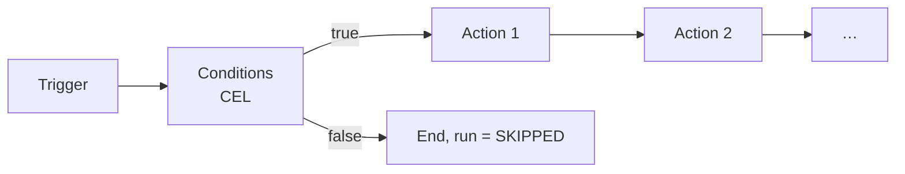

# Automation & Integration

Two equally capable ways to automate every feature:

1. **Externally** — n8n, Zapier, Make, your own scripts: the complete REST API plus webhook subscriptions plus trigger polling.
2. **Internally** — the built-in rule engine: trigger → conditions → actions, with access to
   **every** business use case as well as outbound webhooks and HTTP calls.

Both use the same use case catalogue and the same event types; no feature is available only one way.

---

## 1. The rule model



```json
{
  "name": "Escalate overdue approvals",
  "scope": { "type": "COLLECTION", "id": "018f..." },
  "enabled": true,
  "run_as": "018f...",
  "trigger": { "kind": "EVENT", "event_type": "de.hubtask.work.item.overdue.v1" },
  "conditions": [ { "expr": "item.type == 'TASK' && now.hour >= 8 && now.hour < 18" } ],
  "actions": [
    { "kind": "ADD_LABEL", "params": { "label_id": "018f..." } },
    { "kind": "HTTP_REQUEST", "params": { "method": "POST", "url": "https://…", "body_template": "…" } }
  ],
  "throttle": { "max_runs_per_hour": 100, "dedupe_key_expr": "item.id" },
  "on_error": "CONTINUE"
}
```

A rule holds at most 20 conditions (all must hold) and at most 50 actions; branches nest at most 3
deep. The scope is the workspace (`TENANT`), a `HUB` or a `COLLECTION`.

### 1.1 Triggers

**All seven kinds feed one engine.** A trigger decides *when* a run starts and what makes it one
occasion; everything else is §2's. The run records the kind that started it on its own row, as a
rule can be edited into another kind.

| Kind | Example | What starts a run | What makes it one occasion |
|---|---|---|---|
| `EVENT` | Any domain event; field filters through `changed_fields` | The outbox dispatcher, through the matching subscriber | The event |
| `SCHEDULE` | RRULE with a time zone ("Mondays at 08:00") | The tenant's poller, when the stored `next_run_at` has come | The occurrence's instant |
| `RELATIVE_DATE` | "24 h before the due date", anchored on `DUE_DATE` or `CREATED_AT` | The same poller, when a stored occurrence has come | The occurrence row |
| `MANUAL` | A button, an API call or an MCP tool | `POST /automation/rules/{id}:trigger` | The run, so two presses are two runs |
| `INBOUND_WEBHOOK` | A token-protected URL per rule; the body is `payload` in CEL | `POST /automation/inbound/{token}` | The delivery, so two posts are two runs |
| `JUMBLE_ENTRY` | A new arrival in the jumble, the basis for automatic conversion | An arrival in the jumble | The entry |
| `STEP_TAKEN` | One step of one workflow, by the workflow's key and the step's (UC-FLW-04) | The step itself, inside its transaction | The step's `item.updated` |

`STEP_TAKEN` is the one kind that runs **synchronously**: the step hands its announcement to the
engine inside its own transaction, so what the actions change on the entry commits with the step
or not at all. The engine is otherwise the same - the run log, the throttle, `run_as` and the depth
bound; a rule on a step that takes another step nests one deeper each time. A failing action ends
the run as its `on_error` says and the run is recorded with the step; only an error of the engine
itself refuses the step. A `RETRY` rule is not retried, since no job carries the run.

The idempotency key (§2.0) names the occasion as the table gives it, never an absent event — else a
second manual press would find the first's answer and do nothing.

#### `SCHEDULE`

RRULE through the installation's one schedule engine
([ADR-0008](../adr/ADR-0008-jobs-and-scheduling.md)), DST-correct through both transitions.
`DTSTART` is the rule's creation instant, so `FREQ=WEEKLY` written on a Tuesday means Tuesdays.

The moment is **stored** on the rule (`next_run_at`), expanded at the write (§2.2), not on every
pass.

**Nothing enumerates tenants** ([multi-tenancy.md](./multi-tenancy.md) §2.1). The write that makes
something owed (for a rule, the *enable*) seeds that tenant's poller; each round reschedules itself
to the next owed moment, and a poller with nothing owed finishes until a write brings it back.

**Enabling recomputes from now**: a schedule off for a week owes nothing for that week. A backlog
produces **one catch-up run, then forward**.

#### `RELATIVE_DATE`

A row per (rule, entry) says when that rule owes that entry a run — the `reminder` table's fact with
a rule in place of a person — kept in step with its anchor by a subscriber; a **cleared anchor owes
nothing**, nor does an entry in the trash or gone. The `SCHEDULE` poller serves it too.

**A rule takes effect for what happens after it is switched on**; nothing walks earlier entries.

#### `MANUAL`

The only kind a *person* pulls: a registered use case behind `:trigger`, needing the **plain**
automation permission at the rule's scope — not §2.1's composition check, since pressing changes
nothing about what the rule may do. It queues; the `202` carries the future run's identifier, and the
run records who pressed. A rule that is off, or not `MANUAL`, is refused.

#### `INBOUND_WEBHOOK`

A token-protected URL per rule: 32 bytes of entropy, hashed with the installation secret under its
own purpose label, shown **once**, prefixed `hbt_hook_` so secret scanning finds a leak.

* **Rotating is revoking.** One address per rule, replaced in one statement; revoking without a
  replacement is switching the rule off.
* **The token names its own tenant** in clear: the lookup behind row level security needs a tenant
  context ([multi-tenancy.md](./multi-tenancy.md) §2.2), and the hash covers the whole string, so a
  token rewritten to another tenant matches nothing.
* **It authenticates the rule, never a person**: the run carries no actor and acts as `run_as`.
* The payload enters CEL as `payload`, as **data**, never as an instruction
  ([ai-first.md](./ai-first.md) §1.3). The request middleware bounds the transfer, the route bounds
  the evaluation, and a body that is not a JSON object is refused.
* An unknown, rotated or deleted token, a switched-off rule and a rule whose trigger changed all
  answer the same `404` with the same body ([security.md](./security.md) T-19).

### 1.2 Conditions

**CEL (Common Expression Language)** — declarative, sandboxed, terminating
([ADR-0009](../adr/ADR-0009-automation-rules-cel.md)). Variables: `event`, `item`, `parent`,
`collection`, `hub`, `actor`, `now`, `payload`, `tenant` (its settings), plus library functions for
dates, sets and strings. `cel-go` is imported by exactly one package, which a gate names; the core
never learns of it (ADR-0001).

* **The variable list is a contract**, declared to the compiler: an expression naming anything else
  fails at the write. The values are dynamic documents, so `has(item.cover)` answers for a missing
  field.
* **`item` carries its sets beside the entry**: `item.labels` and `item.members` as identifiers,
  and `item.links` as the entry's links from both ends - each `{type, outward, other_id}`, the
  type's key, whether the entry is the link's source, and the far end's identifier, never a title
  (F-3, UC-PLN-01): `item.links.exists(l, l.type == 'depends_on' && l.outward)`.
* **Compiling is separate from evaluating**: a mistake is answered at the write, with line and
  column. A condition must produce a boolean, a template text; where CEL cannot decide the type
  statically, the value is checked.
* **Values are resolved lazily and once.** A declared name the activation cannot produce fails the
  evaluation rather than reading as false.
* **`now` is one instant per run** from the `Clock` port, and it is the server's:
  `event.occurred_at` is the person's moment (for an offline change, the device's bounded reading),
  `event.received_at` when the server learned of it ([offline-sync.md](./offline-sync.md) §8), so a
  three-day-old completion does not fire a deadline rule.

| Limit | Value | Note |
|---|---|---|
| Expression length | 4096 bytes | Checked **before** the parser |
| Nesting depth | 64, as the parser counts it | Length does not bound type-checking; depth does. Compiling also has a 1 s deadline, a backstop (`expression.too_complex`) |
| Cost | the evaluator's own budget | Bounded statically too: an expensive rule is refused when saved |
| Timeout | 50 ms | **Per expression**, not per rule |

### 1.3 Actions

Every action is an adapter over a use case, and **every use case in the catalogue is an action**:
the kind is the use case name in `SCREAMING_SNAKE_CASE`, derived by
`usecase.Descriptor.AutomationAction` (`AddLabel` is `ADD_LABEL`). The served kinds, their fields and
summaries are answered by `GET /meta/capabilities` (§1.5), never listed here. The engine's flow kinds
`WAIT`, `BRANCH` and `STOP` are in no catalogue; a client names them itself. An action meets its
use case's refusals, the collection's structure among them: writing a value or a level the
entry's collection hides fails the step with `capability_not_supported`
([domain-model.md](./domain-model.md) §2), and the run records it.

A planned kind not yet served is refused as §2.2 says; notification actions are not built
([UC-AUT-09](../usecases/automation/UC-AUT-09-have-a-rule-tell-people.md)).

**The flow kinds.**

* `WAIT` suspends the run instead of sleeping on a worker: results so far are written under
  `WAITING`, a job with the queue's `run_at` carries the resume point. A rule edited while a run
  waits ends that run (`automation.rule_changed_while_waiting`).
* `BRANCH` is a nested list, not a jump target; both arms are checked at the write. The run log names
  each action by its path (`2/then/0`), which is also the idempotency key's third part.
* `STOP` ends the run, which succeeded.

**The outbound pair enqueues rather than calls.** `SEND_WEBHOOK` delivers the run's event to a named
subscription through the webhook pipeline (§3.1). `HTTP_REQUEST` runs on a detached job through the
guarded client with the webhook ladder's eight attempts. **A rule cannot read an answer** (ADR-0009):
the response is bounded by the client's size cap and discarded.

**AI actions** (such as `AI_CLASSIFY`) each queue one question; an AI call never sits in a run.
`apply` is **false unless said**; an applied answer is first recorded as a suggestion with
provenance, its acceptance audited as its own act, the change made through the owning use case as
`run_as`. A workspace with no provider or no consent is refused before anything is queued.
Every use case is an action, the AI reads included: `FIND_DUPLICATES_BY_TITLE` and
`READ_AI_BUDGET_STATE` change nothing and answer a rule as they answer a person. **The AI family**
is every action of a use case that asks or reads AI (`apps/webapp/src/lib/automation/aiactions.json`,
held against the catalogue by `test/architecture/aifamily_test.go`): the editor draws it in the
`ai.*` colours and offers none of it to add where the manifest announces no AI (UC-AI-01 check 1);
a rule that already holds such a step still shows it.

**Templating.** A parameter is the value written, never an expression: a title is that title, a
due date that instant. The one template is an `HTTP_REQUEST`'s `body_template`, a CEL expression
producing text, compiled at the write and rendered from the run's event at each attempt, so a retry
sends what the first attempt would have; `throttle.dedupe_key_expr` is the other text the rule's
language produces (§2.0).

### 1.4 Recurring tasks

A `RecurrenceRule` on the item, so series work without automation permissions; rules can create
and change series (`SET_RECURRENCE`, `SKIP_OCCURRENCE`).

---

### 1.5 What a rule editor is built from

These bind every client that writes rules; the web client's editor is
`apps/webapp/src/lib/automation/`.

**The vocabulary is answered, never compiled in.** `GET /meta/capabilities` answers
`automation.triggers`, `automation.actions`, `automation.action_summaries` and
`automation.action_fields` — per kind, the use case's declared fields (`usecase.Field`, with
`format` such as `date-time`, and `rule`, false for plumbing a rule never sets, such as a
client-minted `id` or `expected_version`), derived from the descriptor as the MCP tool schema is. A
newly served use case is one more block without a client release.

* An action's form is rendered from its declared fields: `rule: false` hidden, `date-time` a
  date-and-time control, anything unmarked text; what the run supplies (§2.2) is one line.
* An `id` field the reference table of §2.3 knows is a picker over the client's store of that kind.
  **A rule names things by identifier**, so a rename keeps working and only a deletion is a finding.
* An event type or action kind is said in words derived from its name through one table of entities
  and verbs, the wire name as a hint; an unknown name shows as its segments. Every block carries its
  kind's icon ([design-system.md](../design/design-system.md) §12).
* A rule has no free description: the sentence generated from the rule is its description.

**The head is the rule, the canvas is the run.** The rule is a vertical path — §1's model is a list
with nested branches, and a free graph would draw freedoms the engine lacks:

* the trigger card (the only one in the signature colour), the gate holding the condition, the chain
  of actions — `BRANCH` a fork into *then* and *otherwise* that rejoins, `WAIT` a pause with its
  duration — and the end mark *Run ends*. Every gap is one line with one insertion point.
* What bounds the rule — `run_as`, scope, `on_error`, throttle — is said in the head and set on the
  *Rule* tab, never drawn as a card.
* The canvas shows; one panel beside it sets, on every width: **Rule**, **Blocks**, **Details**,
  **Probe**, **Runs**. No form on the canvas.
* A block's colour says its family everywhere: trigger signature, gate amber, flow violet, entries
  blue, people (assignment) teal, outbound slate, AI green. A condition belongs to the gate or a
  branch, never a block of its own.

**Branches, ladders and the end of a run.**

* **+ Else if** appends a rung (a branch as the sole step of the else arm), drawn as a ladder and
  read back by the same rule; a removed rung hands its *otherwise* to the rung above.
* `STOP` is called **End the run** and stands only as the last step of an arm, refused elsewhere
  with a sentence. When every arm of a branch ends the run, nothing may follow it, and the end mark
  reads *Run ends — on every path*; steps a stored rule carries after a stop are drawn faded, *never
  reached*.
* Below `bp.expanded`, and from the second nesting depth on any width, a branch shows one arm at a
  time behind a *then (n) · otherwise (n)* switch. Any branch folds to one line; a folded ladder
  counts its rungs.

**Conditions.**

* A condition is composed as sentences over a bounded set of subjects and their comparisons
  (`model.ts`), grouped under *all of* / *any of* / *none of*, and stored as one parenthesised CEL
  expression (§1.2), shown under the sentence; *edit as expression* switches to raw text, and a
  compile error shows the server's line and column. The reader takes apart only shapes the composer
  writes; anything else stays an expression.
* The editor offers the gate **exactly one** condition. A stored rule with several keeps them, each
  removable: a client never silently rewrites what somebody wrote.

**Moving pieces.**

* Every card — a whole branch with its arms included — moves to every gap that may take it, by drag
  and by arrows; every drag has a keyboard equivalent.
* While a piece is lifted only valid places become labelled targets; a refused drop is explained in
  one sentence in the hint line at the canvas's top edge.
* Every served kind is reachable by eye and by search in one list, drawn by the *Blocks* tab and the
  `+` popover: *Blocks* (most frequent, trigger kinds, then `words.ts`'s curated groups) and *All*
  (every kind by area). The popover is filtered to what its gap may take and says so.
* A click on the background or `Escape` clears the selection; the panel moves to *Blocks* unless on
  *Probe* or *Runs*, and a narrow-screen sheet closes.
* Cards are border-box, and the canvas keeps a gutter no narrower than the selection ring.

**Name and sentence.** The client generates a name from the trigger and first steps in the person's
language; a stored name equal to it is *automatic* and follows every edit, any other is owned until
cleared. The rule's sentence stands collapsed under the name.

**Describe it** ([UC-AUT-10](../usecases/automation/UC-AUT-10-describe-a-rule-and-get-a-draft.md)).
The editor of a new rule offers it where asking could succeed - AI available to the person, the
plan including rules, `AUTOMATION` here. A sentence is drafted into a `RULE` suggestion
([ai-first.md](./ai-first.md) §2) and drawn on the canvas as an unsaved new rule, the probe tab open,
with a strip naming it a proposal and listing what could not be drafted. The draft carries no name
and no `run_as`; *Save* is the acceptance, `CreateRule` with the canvas as the overrides, so the rule
is stored switched off like every new one. Not offered on a stored rule: a draft replaces a canvas.

**Review, probe, runs and health.**

* The probe sends the canvas as it stands to the dry run (§2), its sample the trigger's event type
  and a real entry as `subject`, plus a payload for an inbound rule.
* A dry run's and a recorded run's results are drawn alike on the canvas: per condition *held* or
  *did not hold*, the taken arm lit, *would run* per action, the status at the end.
* Before probing, the client reviews the **draft** against its manifest (`review.ts`, codes
  `app.flow.review_*`), drawn where findings are, refusing nothing; a server finding at the same card
  wins.
* A rule's health is client arithmetic over its last page of runs (20): *works*, *fails sometimes*,
  *failing* (more failures than not), plus *off*, *needs attention* and *broken* from the switch and
  findings; the server keeps no health statistic. The rules list says it from findings, switch and
  failure count, each rule carrying its `last_run`, so the list costs one request.
* `/administration/runs` is the one record of every run: a rule links to it prefiltered, a failed
  run is replayed there, and it shows this hour's runs against `automation_runs_per_hour` from
  `GET /quotas`.

## 2. Execution, security, observability

| Aspect | Implementation |
|---|---|
| Triggering | Outbox dispatcher → automation engine (in-process or its own deployment) |
| Delivery guarantee | At least once; per-action idempotency (§2.0) |
| Permissions | The rule runs as `run_as` and can never do more than that account: every action goes through the registry a person's request uses and the same authoriser (ADR-0005). A run is *granted* the token scope its action declares, since a rule presents no credential and the role decides. Writing a rule: §2.1 |
| Loop protection | `causation_depth` in the event; abort at depth 5 by default (`ABORTED_LOOP`) |
| Replays | An event marked `replay: true` was produced by a restore ([backup-restore.md](./backup-restore.md) §8.4); the dispatcher hands it only to a subscriber that asked (`eventbus.TakesReplays`), and the engine does not |
| Throttling | Per rule and per tenant; the dedupe key prevents a storm during mass changes |
| Error handling | `on_error ∈ {STOP, CONTINUE, RETRY}`; five consecutive failed runs disable the rule (§2.0) |
| Dry run | `POST /automation/rules:test` with a sample event → which conditions match, which actions *would* run, both arms of every branch; nothing below it opens a writing transaction |
| Log | A `RuleRun` with timestamps, condition and action results and errors; filterable by rule and `since`/`until` on `started_at`; a `FAILED` run is replayable (`POST /automation/runs/{id}:replay`), completing under its original keys, audited with the replayer |
| SSRF protection | Outbound calls go through `GuardedClient` ([security.md](./security.md) T-07) |
| Secrets | An `HTTP_REQUEST`'s header secret is sealed at the write under a purpose naming the rule, masked as `***` in every response, opened for one call; `***` sent back on an edit keeps it |

### 2.0 How a run happens

1. **The dispatcher hands the event to a subscriber**, which selects the enabled rules with this
   event as trigger, narrowed by scope, in the dispatcher's transaction and without the use case
   registry. An event of a private hub matches only a rule whose `run_as` reaches the hub, so no
   condition reads it and no action sends it anywhere; the run asks again when it starts
   ([identity.md](./identity.md) §22).
2. **One job per matching rule**, not per event: failure isolation, backoff and dead letter per rule.
3. **The engine runs the job** in the queue runner's transaction: the run row, the actions' effects,
   the idempotency records and the job's completion commit together; after a crash none stands and
   the job is claimed again.

Inside a run, the cheapest refusal comes first: **depth**, then **throttle**, then **conditions**
(reads), then **actions** (writes).

**Where the workspace's plan leaves the rules out** ([multi-tenancy.md](./multi-tenancy.md) §4.2) no
event queues a run, a schedule moves on from now without firing, a relative-date occurrence that
falls due meanwhile is dropped, a run queued before runs into nothing and a waiting run ends
(`plan.not_included`, outside the streak); drafting, creating, changing, switching on, testing, starting and
replaying a rule are refused, switching one off and deleting it stay. An action whose own feature
the plan leaves out - a `SEND_WEBHOOK` on a plan without webhooks - is skipped, not failed, so no
rule switches itself off for it.

**No run acts as or about a person whose processing is restricted** (Art. 18,
[data-protection.md](./data-protection.md) §4). Before its conditions - and again at the resume of a
waiting run - the engine reads who is restricted: a run whose `run_as` is restricted ends `SKIPPED`
with `automation.run_as_restricted`; one whose event a restricted person caused, whose entry they
created or are on, or whose intake entry they sent ends `SKIPPED` with
`automation.subject_restricted`. No rule puts a restricted person on an entry: assigning them or
adding them as a member is refused with `items.assignee_restricted` and recorded as a skipped action;
a create, a copy or a template that would carry them makes the entry unassigned. By hand nothing is
restricted.

**Every run is recorded**, written `RUNNING` before the conditions are evaluated.

| Status | What happened |
|---|---|
| `SUCCEEDED` | The run reached its end; under `on_error: CONTINUE` some actions may have failed, as the per-action results say |
| `SKIPPED` | A condition answered no — the ordinary answer of a working rule; or a restriction held the run back, its code saying so |
| `THROTTLED` | The rule has already run as often as it may this hour; conditions not asked |
| `FAILED` | An action refused under `STOP`, or a condition could not be evaluated |
| `ABORTED_LOOP` | The chain reached `causation_depth` 5. The run did nothing |
| `WAITING` | Parked on a `WAIT`; a scheduled job holds the resume point, no worker is held |
| `RUNNING` | In flight, or a crash |

**Idempotency is per action**: `(rule_id, occasion, action_path)` — the path, as a rule may add two
labels. A failed action's claim is released with its failure, so a replay performs what the first
run did not; a redelivered event is recorded again and acts on nothing.

**The dedupe key is the queue's.** `job.dedupe_key` is unique per kind while pending or running.
Without `dedupe_key_expr` the key names the rule and the occasion and nothing collapses; with one it
names the rule and the expression's value, which collapses a storm. The expression is a template
(`item.id` is a value).

**`on_error: RETRY` is the queue's** backoff and dead letter, never a second one in the engine. A
skipped, throttled or aborted run never comes back.

**The failure counter counts runs**; any non-failed run, a skip or throttle included, ends the
streak. At five consecutive failures the rule switches itself off and its **author** (not `run_as`,
perhaps a service account nobody reads) is notified, the rule as the notification's subject.

The engine refuses its own three events as the loop protection's first line.

### 2.1 Who may write a rule

A rule acts later, as another account, unwatched; with only the automation permission a member
could launder rights **through the `run_as`**. All three must hold:

1. **The automation permission at the rule's own scope** — the matrix's column, resolved down the
   scope's path. A member's cell reads "own rules".
2. **You cannot delegate more than you hold.** The `run_as` account's effective role at the scope may
   not exceed the writer's there. A **person's** account other than the writer's own is refused
   outright — impersonation is not even an owner's to grant (`automation.run_as_not_delegable`,
   `automation.run_as_exceeds_writer`).
3. **You must hold what the actions ask for.** The writer's credential must carry every scope the
   actions' use cases declare (`automation.writer_lacks_action_right`).

All three are asked again when a rule is **switched on**, none when it is switched **off** or
deleted: whoever may manage rules must always be able to stop one. An edit is checked against the
rule as it stands and as it would be. **The run is the boundary**: every action is authorised again
as `run_as`, so a later role change narrows the rule.

### 2.2 What a rule may say, and when

A rule that cannot run is not stored: stored and ignored is worse than refused.

| Written | Answer |
|---|---|
| A **condition**, and `throttle.dedupe_key_expr` | Compiled at the write; refused with line and column if it does not compile (`automation.condition_invalid`), or as empty. A build without an expression engine stores no condition |
| An action kind the catalogue does not serve | `automation.action_unknown`, or `automation.action_not_available_yet` for a planned kind (§1.3) |
| A parameter the action's use case does not declare | Refused, as the call itself would refuse it |
| A **required** parameter the rule does not carry | Accepted: the run supplies the rest and the registry validates the whole input then. The check names one the run cannot supply either (§2.3) |
| A **trigger** of any of the seven kinds | Accepted with the fields its kind needs and no others (`automation.trigger_field_not_for_kind`) |
| A `SCHEDULE` whose **recurrence** this installation cannot expand | Refused, the field named. An *exhausted* recurrence is stored with no next moment |
| An **address** on a rule whose trigger is not `INBOUND_WEBHOOK` | Refused by name |

**The run supplies** only `event_id` (the starting event) and `item_id` (the event's subject, or a
relative date's entry), merged into a declared field the rule left unset; a run about no entry
supplies none, a `JUMBLE_ENTRY` run `entry_id` instead.

A rule is created **switched off**; enabling is its own call with its own audit entry.

---

### 2.3 The check

**The check speaks before** a run fails ([ADR-0060](../adr/ADR-0060-rule-check.md)).

`CheckRules` resolves every reference a rule carries against what exists now: the trigger's event
type against `event.Types()`, action kinds and parameter keys against the catalogue, every condition
against the compiler, `run_as` against the workspace's accounts, and every `id` parameter the
reference table in `core/application/service/automation/Check.go` (`referenceFields`) knows against
its store through one `References` port. It also names a required parameter neither rule nor run
supplies (`automation.finding.parameter_missing`) and an acting account with no membership on the
rule's scope path (`automation.finding.runner_without_role`).

It writes `findings` (`{level, path, code, params}`, `path` the JSON pointer a write-time field
error carries) and `checked_at` on the rule. `ATTENTION`: the rule runs, but a step finds nothing
where it points. `BROKEN`: it cannot run, and the check switches it off as the failure streak does —
audit entry `automation.rule_disabled` with `reason: check`, author notified, metric counted by
reason.

* It runs **on demand** (`POST /automation/rules:check`, called when the rules screen opens) and **on
  the deletion events** of labels, buckets and containers, and on a label's restoration (which
  clears what its deletion found), as one `automation.check` job per tenant — never on a timer,
  never across tenants.
* It does not re-run §2.1's rights checks and repairs nothing.
* **An edit leaves the rule unchecked** (findings emptied, `checked_at` cleared); a client asks for
  the check right after a save.

## 3. External automation

### 3.1 Webhook subscriptions (push)

Where the workspace's plan leaves webhooks out ([multi-tenancy.md](./multi-tenancy.md) §4.2) no event
owes a delivery, a delivery queued before is not sent and not settled - it stays `PENDING`, and
nothing counts towards switching the subscription off - and a subscription may be paused, given a
new secret and removed, but not added, changed, resumed, sent to or replayed (`plan.not_included`).

* `POST /api/v1/integrations/webhooks` with `target_url` and `event_types[]`, and optionally a
  `scope` and a `filter` ([UC-INT-01](../usecases/integration/UC-INT-01-receive-workspace-events-on-my-server.md)).
  An event of a private hub is delivered only where the subscription's creator reaches the hub
  ([identity.md](./identity.md) §22).
* **Scope:** `{type: TENANT|HUB|COLLECTION, id}`, a rule's shape and meaning (§1): a hub includes its
  collections, an entry's event is judged by its collection (a move by where it landed), a
  container's by itself and its hub, and an event about no hub or collection reaches only a
  subscription of the whole workspace. Writing a subscription asks the automation permission at its
  scope (and, on a move, at the old one too), after checking that the container is this
  workspace's and of the named type (`containers.not_found`, `webhooks.scope_type_mismatch`);
  reading asks it, or configuration-read, there, and the listing answers what the caller may read.
  Omitted is the whole workspace; on an update `{type: TENANT}` widens it again.
* **Filter:** a boolean condition in the rules' language (§1.2) over a smaller set of names - `event`,
  `data` (the CloudEvent's `data`, as the receiver gets it), `actor` and `now` - because the
  dispatcher does not read the work context (`condition.WebhookEnvironment`). It is compiled with
  the rules' bounds when saved and refused with `webhooks.filter_invalid` and the expression's code
  at `/filter`; an empty string removes it. **An event whose condition cannot be evaluated is not
  sent**: it is a delivery row with status `FILTER_FAILED`, attempt 0 and the expression's code as
  `error_code` - never the condition's text - listed and narrowable in the delivery log, not
  replayable, and gone with the log's thirty days. Failing open would send what the subscriber
  narrowed away; failing the dispatcher's batch would stop every other subscriber. The trail
  records `filter_set` and the scope, never the condition (rule 10).
* Payload: **CloudEvents 1.0** (structured JSON), identical to the internal event.
* Signature: `X-Hubtask-Signature: t=<ts>,v1=<hmac-sha256(secret, ts + "." + body)>`, replays bounded by a time window.
* Headers: `X-Hubtask-Event-Id` (for deduplication), `X-Hubtask-Event-Type`, `X-Hubtask-Delivery-Attempt`.
* Retries: 8 attempts with backoff up to 24 h, then dead letter, visible under
  `/integrations/webhooks/{id}/deliveries` and replayable manually.
* Auto-disable after sustained unreachability, with a notification to the owner.
* Zapier-compatible self-management: `subscribe`/`unsubscribe` through the API (the REST hooks pattern).
* Deliveries of one sync push are collapsed ([offline-sync.md](./offline-sync.md) §8).

### 3.2 Trigger polling (pull)

For platforms without a stable public URL:
`GET /api/v1/integrations/triggers/{eventType}?since=<cursor>&limit=100` returns events in ascending
order with a stable cursor, deduplicable through `event_id`.

* Payload: the CloudEvents document a webhook would have received; `id` is its `X-Hubtask-Event-Id`.
* The cursor is opaque and signed and names an outbox position, so it survives restarts and
  failovers. `since` absent starts at the oldest event inside the window.
* **Retention bounds the window**: dispatched events are kept for `OUTBOX_EVENT` (seven days by
  default); an older cursor is `410 gone` with `triggers.cursor_expired`, never silently restarted.
* **Authorisation is the event's, not the endpoint's.** A poll needs `automation:manage` (as a
  webhook subscription does) *and* the event type's own read scope
  (`core/domain/event/ReadScope.go`); an event of a private hub is answered only to a caller who
  reaches the hub.
* **A poll reads a moment behind the present.** `occurred_at` is stamped by the writing transaction,
  not its commit, so an earlier transaction can commit a row behind an answered cursor; rows younger
  than `HUBTASK_TRIGGER_POLL_LAG` are withheld from page and cursor until the next poll. Webhooks are
  not delayed.
* A replayed event is not answered, as it is not delivered (backup-restore.md §8.4).
* An event type this build does not declare is refused by name, not answered with an empty page.

### 3.3 Recommendations for n8n/Zapier/Make

| Need | Endpoint |
|---|---|
| Trigger "new task" | A webhook subscription on `item.created`, or polling |
| Action "create task" | `POST /items` with an `Idempotency-Key` |
| Action "set field" | `PATCH /items/{id}` with `If-Match` |
| Search | `POST /search` for text, `POST /items:query` for a filter |
| Bulk import | `POST /items:bulk` |
| Auth, simple | A personal access token (header `Authorization: Bearer hbt_pat_…`) |
| Auth, marketplace | OAuth2 authorization code + PKCE (a prerequisite for the Zapier marketplace) |

The **n8n community node** (`packages/n8n-nodes-hubtask`) and the **Zapier app**
(`packages/zapier-app`) are generated from the contract — one operation per use case, one trigger
per event type — and a test per package proves them complete
([ADR-0058](../adr/ADR-0058-connector-packages.md)).

### 3.4 Chat rooms

A subscription's `format` says what its target receives
([UC-INT-12](../usecases/integration/UC-INT-12-tell-our-chat-room-what-happens.md)): `CLOUDEVENTS`
(the default, §3.1) or a chat room's sentence - `MATRIX`, `SLACK`, `MATTERMOST`, `TEAMS`. A chat
room is the same subscription: its types, filter, scope, retries, dead letter, switching off and the
plan's bounds are §3.1's, and only the body and the credential differ. The format names a wire
protocol, as an import format does (engineering-guidelines.md §2, item 17).

* **The sentence** is the catalogue's `chat.<entity>_<verb>` in the subscription's `locale` (absent
  is the source language; `chat.event_other` for a type without one), the entry's title where the
  event carries it, and a link to the entry under the installation's base address - never a note,
  a comment's body or any other field a person wrote ([data-protection.md](./data-protection.md)
  §9's rule for mail). Matrix receives an `m.notice` with an HTML body; Slack its `text`; Mattermost
  Markdown with the title escaped; Teams an Adaptive Card whose link is an action.
* **Matrix**: `target_url` is the homeserver, `room` a room identifier (`!opaque:server`; an alias
  is refused), and `credential` the sending account's access token, sealed in the secret's place
  and never answered. A delivery is `PUT /_matrix/client/v3/rooms/{room}/send/m.room.message/
  hubtask-{event id}`, so a retry of one event is one notice.
* **Slack, Mattermost, Teams**: `target_url` is given as the room's incoming webhook address. It
  admits whoever holds it, so it is sealed in the secret's place and the stored, listed and audited
  target is its origin alone; a delivery whose opened address left that origin sends nothing and
  ends `webhooks.target_mismatch`.
* **Not signed, not rotated, not moved**: a chat room carries no `X-Hubtask-Signature`, its creation
  answers an empty `secret`, a rotation is refused (`webhooks.chat_not_signed`) and so is a new
  target (`webhooks.target_fixed_for_chat`) - another room is another subscription. The format is
  fixed at creation. The trail records the format and the Matrix room, never the credential.
* Link unfurls and commands from a room are not built (UC-INT-12, *Where it ends*).

### 3.5 Code from a forge

A hub's forge hooks ([UC-INT-13](../usecases/integration/UC-INT-13-see-the-code-that-names-an-entry.md))
take GitHub's, GitLab's, Forgejo's and Gitea's webhooks at `POST /code-intake/{tenantId}/{hookId}`
and keep each commit, branch and pull request on the hub's entries whose key it names. The kind
names a wire protocol (engineering-guidelines.md §2, item 17); nothing calls the forge.

* **Trust**: GitHub signs the body with the hook's secret (`X-Hub-Signature-256: sha256=…`),
  Forgejo and Gitea likewise without the prefix (`X-Forgejo-Signature`, `X-Gitea-Signature`),
  GitLab sends the secret itself (`X-Gitlab-Token`). The secret is derived, never stored:
  HMAC-SHA-256 under the installation key's own purpose label over the workspace, the hook and the
  hook's salt; drawing a new secret draws a new salt (security.md §5). A delivery is remembered
  three days by the forge's delivery identifier (`code_delivery_seen`) and one repeated is refused.
  Every refusal is one `404`, `forge.hook_not_found`.
* **Who writes**: a delivery writes as the person who last defined the hook, only while they hold
  WRITE_ITEMS on the hub, and only on the hub's own live entries; a key is read as the mail intake
  reads one (`HANDLE-42`, standing alone before its number ends, at most ten a signal).
* **Order**: a link follows the forge's own moment; an older signal is ignored and a merged pull
  request stays merged. A push names its branch (closed when deleted) and its commits; a pull
  request (GitLab's merge request) its title, branch and description.
* **Offline**: a link is the change log's `code_link`, filed under its entry's collection.
* **Retention**: a hook is switched off, never removed; its links go with their entry.

### 3.6 A calendar feed pushed into a calendar

A person's calendar feed is written into their own calendar at Microsoft 365 (Graph,
`/me/events`) or Google (Calendar API, the primary calendar)
([UC-INT-16](../usecases/integration/UC-INT-16-write-my-calendar-feed-into-my-calendar.md)).

* **Consent**: the mailboxes' installation apps (`HUBTASK_MAIL_OAUTH_*`) with PKCE and a scope for
  the calendar's events alone (`Calendars.ReadWrite`, `calendar.events`); the provider sends the
  browser back to `/profile/calendars`, which the operator registers as a second redirect URI.
  The refresh token is sealed under the push's own purpose label; a rotated one is sealed again.
* **Run**: one detached `calendar.push` job per push, every quarter hour. It reads the feed as its
  owner now - the `.ics` route's own reader - and compares each entry's digest with what it wrote
  (`calendar_push_event`): new entries are created, changed ones patched, gone ones deleted.
  Events are free, without a reminder, a timed entry half an hour long.
* **Refusals**: a grant the provider no longer takes or a feed gone stops the push (`FAILED`, its
  code kept); anything else is tried again at the next run.
* **Retention**: disconnecting removes the push and what it wrote is forgotten here; the events
  stay in the calendar. Not archived: the grant opens on one installation only.

---

## 4. Why automation is its own service

Automation carries the most load and risk (third-party targets, long runtimes, rule storms), so it
is its own bounded context, deployable as its own role and run inside the main process in
self-hosting ([ADR-0002](../adr/ADR-0002-modular-monolith.md),
[ADR-0014](../adr/ADR-0014-single-image-multi-role.md)).

---

## 5. Mail into the workspace

**One intake per workspace, any number of doors** ([ADR-0094](../adr/ADR-0094-one-mail-intake-routed-by-handles-and-ticket-keys.md),
superseding [ADR-0040](../adr/ADR-0040-no-imap-intake.md) and
[ADR-0092](../adr/ADR-0092-mail-addresses-for-every-place.md)). The operator's inbound service
posts each raw message to `POST /mail/inbound` (`HUBTASK_MAIL_INBOUND_DOMAIN`,
`HUBTASK_MAIL_INBOUND_KEY` as bearer token or basic password); a connected mailbox (IMAP, or JMAP
where the provider speaks it) is the other door. Hubtask runs no SMTP receiver. The jumble's own
webhook doors (`/jumble/inbound/{token}`, `/jumble/mail/{token}`) stay as they were.

**A connected mailbox** is read by the job `mail.mailbox_poll`, one per mailbox, seeded when it is
connected and rescheduling itself every minute: it signs in (IMAP with TLS, in-house and through the
egress guard; or JMAP through the guarded HTTP client), takes up to 25 messages that arrived since
connecting, hands each to `ReceiveMail` and moves what was filed to the folder *Hubtask*. The
secret is sealed (`mailbox.secret:<id>`) and opened only by that job and *Check now*.

**A mailbox connected through its provider's sign-in** (OAuth 2.0 with PKCE S256, any provider;
Google and Microsoft as presets) is started by `AuthorizeMailbox`, which stores a
`mailbox_authorization` - the state as its hash, the verifier and an own app's client secret
sealed, ten minutes, the administrator who asked - and answers the provider's URL. The provider
sends the browser to `/administration/mail/oauth`; the page hands state and code to
`CompleteMailboxAuthorization`, which takes the row (once), trades the code at the token endpoint
through the guarded client, signs in to IMAP with SASL XOAUTH2 and only then stores the mailbox
with the refresh token sealed. Each read draws an access token first; a rotated refresh token is
sealed in place, a withdrawn grant is the mailbox's failure (`mail.oauth_revoked`). The
installation's own apps come from `HUBTASK_MAIL_OAUTH_{GOOGLE,MICROSOFT}_CLIENT_ID`/`_SECRET`.

**The parser is transport-independent**: bytes in; sender, subject, text, attachments, Message-ID
and the header signals out. `ReceiveMail` behind it knows nothing about MIME.

### 5.1 Names and the routing order

Every collection has a *handle* (`einkauf`, letters and digits, unique in the workspace over
trashed collections too, kept on a rename) and every entry a number in its collection; together
they are the *ticket key* `EINKAUF-42`. On the operator's domain a workspace has a *name*
(`familie`, unique on the installation): `familie@`, `familie+tag@` and `tag.familie@` all reach
it. The first rule that matches decides:

| # | Rule | Becomes |
|---|---|---|
| 1 | A ticket key: `+key-42` / `key-42.` in the address, `[KEY-42]` or `KEY-42` in the subject | a comment on that entry |
| 2 | A handle: `+handle` / `handle.` in the address, `#handle` in the subject | an entry in that collection, the routing words taken out of the title |
| 3 | A sender rule (`@lieferant.de` → *Einkauf*), an exact address before a domain | an entry in that collection |
| 4 | The workspace's default collection | an entry there |
| 5 | Otherwise | a jumble entry with the reason (`NO_ROUTE`, `UNKNOWN_PLACE`) |

### 5.2 Who may write

| Level | Admitted | Writes as |
|---|---|---|
| `MEMBERS` (default) | an active person account of the workspace with the sender's address, SPF/DKIM/DMARC not failed | the sender |
| `MEMBERS_AND_ALLOWED` | and the addresses and `@domains` of the allow list | the sender, or the administrator who saved the settings, headed *From:* |
| `ANYONE` | every sender | as above |

The block list drops a sender's mail before every level. A message marked as spam, unparseable, or
from a sender not admitted lands in the jumble with its reason and the place it named; a member
whose own rights refuse the act lands there with `NOT_PERMITTED`. `Auto-Submitted` other than `no`,
Hubtask's own notification header, and more than 30 messages an hour from one sender are dropped.

### 5.3 Once, and on the record

A receipt per workspace and Message-ID (a digest of the raw message where there is none) makes a
redelivery a no-op and is the log *Administration → E-mail* shows; it is kept 30 days
(`MAIL_RECEIPT`, [data-retention.md](./data-retention.md) §3). A notification about an entry
carries the entry's ticket key on the intake's address as `Reply-To`
(`familie+web-42@in.example.app`), so a reply is routed by rule 1.

## 6. Connectors of the inventory

A connector is a program a hub's configuration items are pulled from, or a monitoring program that
posts alerts to it (UC-AST-07, UC-AST-08; the model in [domain-model.md](./domain-model.md) §3.10;
why: research itsm-cmdb-ai §6.3). It writes as one of the workspace's sources of kind `CONNECTOR`
and through the one reconciliation, so nothing a connector fetches reaches a CI any other way.

### 6.1 Pulling

| Kind | Calls | Pages and cursor |
|---|---|---|
| `GLPI` | the high-level API (v2): `POST /api.php/token` with an OAuth client (`client_id` setting, the secret as credential), `GET /api.php/v2/Assets/Computer` | by offset, changed since the newest `date_mod` the last walk saw |
| `NETBOX` | `GET /api/dcim/devices/`, then `GET /api/virtualization/virtual-machines/`, with `Authorization: Token`; a record's site `contains` it, a virtual machine is `hosted_on` its cluster (a `virtualization_cluster`) and on its device. The setting `dialect` `nautobot` reads Nautobot: `depth=2` and `sort` instead of `ordering`, a `location` in place of the site, `primary_ip4` or `primary_ip6` | by offset, each walk changed since its own newest `last_updated`; the devices' walk, then the machines' |
| `INTUNE` | a token from the `authority` setting's `/{tenant}/oauth2/v2.0/token` (client credentials), `GET /v1.0/deviceManagement/managedDevices`, then - unless the setting `detected_apps` is `off` - `GET /v1.0/deviceManagement/detectedApps` and each app's `/managedDevices`: an app and version is one `software` `installed_on` each device it was detected on | the next page's link; every device and app on every walk, ten apps a page, an app with more devices than a page continued from its next link |
| `ENTRA` | the same token, `GET /v1.0/devices/delta` | the next page's link, then the delta link: a later walk fetches only what changed; a removed device is left alone |
| `HETZNER` | `GET /v1/servers` with the project's token as bearer | by page; every server on every walk |
| `OPENSTACK` | `POST /v3/auth/tokens` with an application credential (`application_credential_id` setting), the public compute endpoint of the catalogue (`region` setting narrows it), `GET /servers/detail` | by marker; every server on every walk |

Every address is the connector's configuration, never the source code's (PG-6): its https base
address, the `authority` of Intune and Entra, and the further hosts it allows - an OpenStack
compute endpoint's, typically. A call to any other host is refused (`connector.host_not_allowed`).
Every call leaves through the guarded client (rule 6) with a deadline of 30 seconds (rule 7) inside
a circuit breaker per connector; 401 and 403 are `connector.unauthorised`, 429 is
`connector.rate_limited` with the source's `Retry-After`, everything else
`connector.unreachable` - the run keeps the code, never the source's words (rule 10).

A run is up to 50 pages, each reconciled and committed in a transaction of its own, so that no call
holds one open; a failure keeps the cursor of the last page written. A scheduled connector is one
job per connector (`cmdb.connector_pull`, deduplicated by the connector), seeded by the definition
and rescheduling itself to the connector's next moment; it runs with the rights of the person who
last defined the connector, as an automation with the item scopes only, and switches itself off
after ten failed runs in a row. A run that fails or fetches nothing fires the hub's one alert about
that connector's runs (key `hubtask.connector_run`, its title the failure's message code or
`connector.run_empty`), in the run's transaction; a run that fetches resolves it, and a dry run
leaves it alone (research itsm-cmdb-ai C8). It names no CI and opens no entry: a pull has no
collection. The credential is sealed under the purpose `cmdb.connector:<id>`
and re-sealed by the connectors' own resealer in a key rotation (store `cmdb_connector`,
security.md §8.1).

### 6.2 Alert intake

`POST /cmdb/alert-intake/{tenantId}/{connectorId}` carries no bearer of a person. Its credential is
the secret Hubtask drew for the intake, presented as `Authorization: Bearer <secret>` - what an
Alertmanager `webhook_config` sends with `http_config.authorization` - or used to sign the body:
`X-Hubtask-Timestamp` in Unix seconds and `X-Hubtask-Signature: sha256=<hex>` of the HMAC-SHA-256
over the timestamp, a dot and the body. A signature older or newer than five minutes is refused and
the digests of the last ten minutes' signatures are kept to refuse a replay (`cmdb_intake_seen`);
every refusal is the same `404`.

| Kind | Format read | Key | Hosts |
|---|---|---|---|
| `ALERTMANAGER` | the webhook's `alerts[]`, `status` firing or resolved, `annotations.summary` as title | `fingerprint`, else `alertname/instance` | labels `instance`, `host`, `hostname`, `nodename` |
| `ZABBIX` | a webhook media type posting `event_id`, `status` (`PROBLEM`/`1` fires, `RESOLVED`/`OK`/`0` resolves), `severity`, `title`, `host`, `host_name`, `host_ip` | `event_id`, else `trigger_id` | `host`, `host_name`, `host_ip` |
| `CHECKMK` | a notification posting `host`, `service`, `state`, `notification_type`, `output`, `address` | `host/service`, or `host` | `host`, `address` |

At most 200 alerts per delivery. An alert is bound to the one CI of the hub a host names by host
name, address or name; with the intake's collection, a firing alert opens an entry there through
`CreateWorkItem` - the registry, as the intake's person - its notes pointing at the CI, and its
resolution completes it (`CompleteWorkItem`), a reopening reopens it (`ReopenWorkItem`).

### 6.3 A GLPI Agent's inventory

A connector of kind `GLPI_AGENT` is an intake a GLPI Agent posts its native inventory to, for
machines no pull reaches: `POST /cmdb/inventory-intake/{tenantId}/{connectorId}` is the agent's
server address. The body is JSON, or zlib- or gzip-compressed JSON recognised by its first bytes
and inflated to at most 16 MiB. A `contact` is answered `{"status":"ok","expiration":24,"tasks":
{"inventory":…}}`; an `inventory` of a `Computer` is one payload of the reconciliation as the
intake's source - the machine by its SMBIOS UUID (the agent's device id when there is none), a
laptop or a server by its chassis or system, otherwise a workstation, with serial, manufacturer,
model, operating system and the first non-virtual address and MAC; each distinct program as
`software` `installed_on` it. The secret is drawn as an alert intake's and presented as a bearer
token, as the password of basic authentication (the agent sends it only when challenged, so a post
with no credential at all is answered `401` with a basic challenge whatever the address) or as a
signature. Every other refusal is the alert intake's one `404`; the run is the connector's last.
