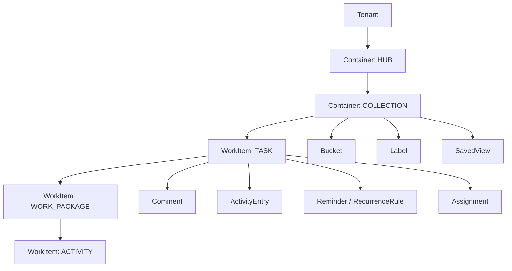
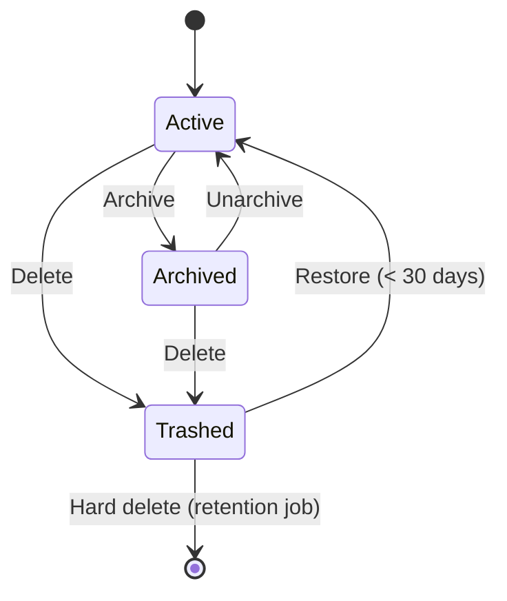

# Domain Model

Binding for `core/domain` and `core/application`: aggregates, invariants, roles, events and the
operation catalogue's rules. Complements [arc42.md](./arc42.md) §5 and §8.1.

---

## 1. The guiding idea: generalisation

One aggregate root `WorkItem` with an `ItemType` and a **capability profile** that defines per type
which capabilities are permitted ([ADR-0006](../adr/ADR-0006-generalized-workitem.md)). Containers
are modelled the same way: `Container` with a `ContainerType` (`HUB`, `COLLECTION`).

The consequence: one table, one repository, one set of use cases, one API resource (`/items`). A
new feature of an existing type is configuration, not a new schema, and so is a new *entry type* on a
level (§2, "Entry types"); a new level is not.

---

## 2. The capability matrix

`ItemCapabilityProfile` is a domain policy. System-defined profiles are defaults; a tenant may
narrow them, never widen them beyond the system boundary.

| Capability | TASK | WORK_PACKAGE | ACTIVITY | Note |
|---|:--:|:--:|:--:|:--:|
| `COMPLETION` (done/open) | ✔ | ✔ | ✔ | Mandatory for every type |
| `DUE_DATE` | ✔ | ✔ | ✔ | |
| `REMINDER` | ✔ | ✔ | ✔ | Predefined plus custom |
| `ASSIGNMENT` | ✔ | ✔ | ✔ | Activity: exactly one assignee |
| `MEMBERS` (several) | ✔ | ✔ | ✘ | |
| `BUCKET` | ✔ | ✘ | ✘ | Buckets apply to items directly under the collection |
| `NOTES` | ✔ | ✔ | ✘ | |
| `LABELS` | ✔ | ✔ | ✘ | |
| `COMMENTS` | ✔ | ✔ | ✘ | |
| `COVER` | ✔ | ✘ | ✘ | A colour or an image |
| `ATTACHMENTS` | ✔ | ✔ | ✘ | |
| `HISTORY` | ✔ | ✔ | ✔ | Compact history for activities |
| `RECURRENCE` | ✔ | ✘ | ✘ | A series applies to the whole subtree |
| `CUSTOM_FIELDS` | ✔ | ✔ | ✘ | |
| `AMOUNT` | ✔ | ✘ | ✘ | Opt-in: carried only where a layer's fields name it (UC-WRK-25) |
| `CHILDREN` | `WORK_PACKAGE`, `ACTIVITY` | `ACTIVITY` | — | The permitted child types; a task may hold both at once (decision #1627) |
| `MAX_DEPTH` | 3 | 2 | 1 | Relative to the collection |

**Entry types** (F-1, UC-FLW-01, migration 0209). A workspace names the kinds of its work as rows of
`entry_type`: a stable `key`, the *level* it sits on (one of the three above, which a type never
changes), a name, an icon of the design system's set, a label colour token, and the behaviours of
its entries - *completable*, *workflow*, *record*, *schedulable*, *estimable* - with the keys of the
types allowed directly underneath. Each level has a **system type** keyed after it (`task`,
`work_package`, `activity`), declared in the domain (`work.SystemEntryTypes`) and stored only once a
workspace changes it; it is never archived, deleted or made a record. An entry names its type by key
in `work_item.entry_type`, null for its level's system type. A type **narrows** its level's profile
and never widens it: a *record* has no `COMPLETION` (D-07), a type that is not *schedulable* no
`DUE_DATE`, `REMINDER` or `RECURRENCE` (`EntryType.Narrow`). A type in use is archived - no longer
offered, still readable - and only an unused one is deleted. Which types a collection offers on a
level is its structure's ninth setting, `entry_types` (below): a level it names offers those keys in
that order, the system type by default where it is among them and the first one in use otherwise,
and a creation or change of type to another is refused with `entry_types.not_offered`
(`EntryTypes.ChooseAmong`); an entry keeps the type it has when the list narrows. The registry belongs to the workflows
module: its operations are refused with `module.off` where the module is off. The `item_type` enum
and the level CHECKs on `work_item` stay as the level's: dropping the enum is a contract step for the
release after the one whose statements stop casting to it (`versioning-release.md` §4).

**Forms** (F-4, D-13, P-18, UC-FLW-01 check 2, migration 0214). A type carries its **form**, the one
layout and logic of every door that creates or edits an entry of it (`work.Form`, stored whole in
`entry_type.form`): sections in order; fields in order, each named `title`, `notes`, `due_date`,
`start_at` or `custom_fields.<key>`, with *required*, *required when*, *read-only when* and
*hidden when*; a default (custom fields only); validations - a condition that must hold, with the
workspace's own words and a key the refusal names; and **channels** that may only narrow the form:
a channel closes itself for creating the type, hides fields and presets them, and never adds a
field or a rule of its own (`model.md` §6 of the suite plan). The channels are the doors the server
tells apart - `APP` (the REST door the web app and hubctl share), `MCP`, `RULE`, `SYNC`, `IMPORT`,
`MAIL` - and the adapter sets one on the actor (`ActorContext.Channel`); a channel the server could
not tell apart would be a narrowing anybody could step around. A condition is CEL over `entry`,
`actor` (`role`, the built-in role; `roles` and `permissions`, every role key - custom ones
included - and every permission held along the path, a list tested with `in`; `kind`), `channel`
and `step`. Saving a form compiles each
condition in the **type's environment**, where `entry` and `entry.custom_fields` are typed maps
(`expression.Variable.Fields`): a field the form does not hold is refused with
`expression.unknown_name` when it is written. One gate holds every write - `EntryGate.Forms`
(`FormGate`), asked inside each writing use case's transaction with the entry as it would be
written (`CreateWorkItem`, `UpdateWorkItem`, `SetCustomField`, `SetDueDate`), so REST, MCP, a
rule, a device's push and mail meet the same refusal; an import into an existing collection asks it
for each entry before anything lands (`HoldImported`, backup-restore.md §9). The rule it applies is that **a write may not
move an entry further from its form** (`CheckFormWrite`): a creation needs every required field and
every validation; an edit may not change a field that was read-only or hidden as the entry stood,
clear a required one, or make a validation fail that held - an entry created before its form is not
refused for what it already lacked. A creation starts with the channel's presets and the fields'
defaults for what the request left out; a field the channel hides takes its preset whatever was
sent. The refusal is `forms.refused` naming each field (`fields.value_required`,
`forms.field_read_only`, `forms.field_hidden`, `forms.validation_failed`), and a closed channel is
`forms.channel_closed`. `EvaluateEntryForm` answers the same state for a draft, so an editor unfolds
what the form asks before it sends: the browser renders the server's answer rather than evaluating
CEL itself. Only while the server cannot be reached does `packages/expression` stand in - the same
conditions over the copy, through `SYNC`, the door the push arrives by - and the push is judged by
the server again; a calculated field of an entry whose writes wait is computed there too.

**Workflows** (F-4, D-02, UC-FLW-02 … 05, migrations 0216/0217). A workspace describes how its work
moves as **workflows** (`work.Workflow`, table `workflow`): **statuses**, each with a stable key, a
name, a label colour token and one of four **categories** - `BACKLOG`, `TODO`, `IN_PROGRESS`,
`DONE` -, the open status a new entry starts in, and **steps**, each from some statuses - or from
any but its own target - to one, with *who* may take it (built-in roles, a person field of the
entry - `assignee`, `created_by`, `custom_fields.<key>` -, a CEL condition), the fields it
*requires*, the fields it *asks* for when taken, and *checks* - a condition with the workspace's
own words for the refusal: one text, words per language (`messages`, a language tag to its text)
or a message picked from the shipped list (`message_code`, `work.StepCheckMessageCodes`); the
reader's client reads its language's words, then the one text, then the picked message. Conditions are CEL in the form's environment with `entry.status`
(`WorkflowEnvironment`). The shipped workflow `default` - To do, In progress, Done - is declared in
the domain (`work.SystemWorkflow`) and gains its row when a workspace first uses or changes it. A
change is a **draft** beside the shape in force, which stays in force until the draft is
**published**. The **scheme** (`workflow_scheme`) names the workflow a hub or collection runs per
type, or for every type: a collection's row wins over its hub's, a type's over the row for every
type (`work.ResolveWorkflow`); where none resolves, no workflow runs. An entry carries its
**status** (`work_item.status`, null where none runs) and **in a workflow collection completion
follows the status's category** (D-02): one gate (`WorkflowGate`) holds every move - `TakeStep`,
`CompleteWorkItem` and `ReopenWorkItem` take a step into or out of a done status the person may
take or are refused (`workflows.step_not_offered`, `workflows.step_not_allowed`,
`workflows.step_refused` naming each empty field and failing check, `workflows.no_step_to_done`),
a roll-up puts a parent where entering the workflow would, a new entry starts in the initial
status, and a device's queued status patch is a `TakeStep`. A step announces `item.updated` with
the status and the step in its change set, so what follows a step is a rule like every other
(the suite plan's `model.md` §2). Using a workflow somewhere, or publishing a draft, moves the
entries of the reached collections by a plan (`work.PlanStatusMoves`): a status the shape keeps is
kept, a removed one goes where the publish's mapping says - required for every removed status in
use (`workflows.mapping_required`) -, and otherwise a done entry enters the first done status and
an open one the initial status; no move changes completion or runs a step's conditions
(`workflows.mapping_changes_completion`). Each moved entry's history says `item.workflow_changed`;
the trail records the counts. Using a workflow needs the person's confirmation of its preview
(`workflows.confirmation_required`). The operations belong to the workflows module.

**Levels and presets** (decisions #1619–#1622). A collection's *level* is a preset — *List*,
*Tasks*, *Project*, *Flow*, or one a workspace or installation defines — that sets eight things:
the levels and their names, the fields (capabilities), the views, what counts, what completion
does, what capture recognises, how success is shown, and what runs by itself. A ninth setting,
`entry_types`, says which entry types each level offers; Hubtask's presets leave it to the layer
above, because the types are a workspace's own, and an installation preset loses it like the
categories. Every setting can be
changed per hub or collection, and a collection inherits from its hub, its hub from the workspace,
the workspace from the installation; an administrator may lock a setting (P-06, P-07). A setting
**narrows** the system profile and never widens it. The effective profile is what the gate below
applies; `policies.structure` holds a container's own layer. A level may carry a name a person
chose; it is that person's content (rule 10), and the translated default applies without one.

How the settings resolve (`core/domain/model/work`, `StructureSettings.go`, `StructureResolve.go`):

* **Layers.** Per setting, the nearest layer that decides it wins: the collection, its hub, the
  workspace, the installation, Hubtask's default. A layer stores *values*; the preset it names is
  provenance only — choosing a preset copies its eight values into the layer and replaces the
  layer's own, and nothing follows a preset afterwards. Hubtask's default is the behaviour from
  before settings existed, so a container nobody configured answers exactly that.
* **Creation.** A collection created with its hub's preset, or with none, stores nothing and follows
  its hub — a later change of the hub reaches it. A hub created without a preset starts from the
  workspace's *default preset*, else from the installation's, which apply to hubs only.
* **Saved presets** (UC-WRK-30, `Presets.go`, table `structure_preset`). Beside Hubtask's four, a
  preset is saved from a hub's or collection's structure in force, its categories left out: the
  *workspace's* (offered to everyone in it; saved, changed and withdrawn with `STRUCTURE` at the
  workspace) or a person's *own* (offered to them alone, gone with their account; another person's
  is unknown to them). Each is answered with its `origin` (`HUBTASK`, `WORKSPACE`, `OWN`); a key
  names one of Hubtask's or a saved one by its id, so a layer's provenance and the default preset
  keep one string. The default preset is Hubtask's or the workspace's, never a person's own, and is
  not withdrawn while it is the default. At most 100 workspace presets and 50 of one person's own.
* **Installation presets** (UC-INS-18, `InstallationPresets.go`, table `installation_preset`,
  multi mode only). The operator keeps up to 50 presets every workspace is offered with origin
  `INSTALLATION` — through the installation's defaults, `/admin/presets`, `hubctl admin presets`
  and the instance file's `presets`. One of them may be the *default for new workspaces*, and only
  the default locks. Its values are not a layer: they reach a hub only by being copied when it is
  created without a preset in a workspace without a default of its own, so choosing a default
  changes no workspace that exists. A workspace's default is never an installation preset, which
  the operator may withdraw without the workspace knowing; the default is not withdrawn while it is
  the default. The installation's *hold* — the default's key, values and locks — travels on the
  `StructureBound`, so every resolution and every writer sees it.
* **The first start.** A workspace in which nobody has made anything yet - no hub or collection
  beyond the ones it was created with (multi-tenancy.md §5), no entry - asks whoever may shape it,
  once, what it is used for (`starter_offered` on `GET /tenant`, `tenant.starter_answered_at`); the
  starter set of hubs and collections on Hubtask's presets is the client's to create, its names
  being words (rule 8).
* **The bound.** Every value at every layer is held inside what the installation offers: the
  system profile intersected with the profiles in force (`item_capability_profile`'s tenant rows
  stay that bound; a workspace narrows through its own layer). A write beyond it is refused with
  `capability_not_supported` (`structure.widens`); a value stored before the installation narrowed
  is clipped on read, never refused. A layer's value is a default for the layers below, not a bound
  on them: a collection may switch dates on under a hub without them.
* **Levels and fields.** *Levels* are the offered types, top-down: a root always, any other type only
  beneath one of its system parents (an activity has two). *Fields* are a capability set per type,
  completion always in it. An **opt-in** capability (`AMOUNT`) is carried only where a layer names
  it: Hubtask's default and a type a layer leaves out keep the behaviour from before it existed,
  and of Hubtask's presets only *List* names it. A level may carry a name for its done entries
  (*In the trolley*), the person's content like the level's own name. A type's fields may name
  **categories**: labels of the collection, in order, that its entries are grouped by - only beside
  `LABELS` and only on a collection's own layer (`structure.categories_collection_only`), each a
  live label of that collection when first named (`structure.category_unknown`); one already named
  stays when its label is deleted, so that undoing the deletion restores the order.
* **Locks.** The workspace locks a whole setting (`views`) or one capability of one type
  (`fields.TASK.DUE_DATE`); a lock answers its origin and who set it. A locked value applies below:
  a lower layer's own value is ignored when resolving and refused when written
  (`structure.setting_locked`); a preset chosen under a lock is accepted with the locked value kept
  and named (`kept_by_lock`). The installation's default preset locks the same way, above the
  workspace: a locked setting takes the default's value with source and lock origin `INSTANCE`, and
  a workspace's own lock or value on it is ignored when resolving and refused when written. The
  plan's locks arrive with their writer.
* **Completion** is the one setting the server applies here: the roll-up (I-W5) follows the value in
  force. A collection's own completion is one stored value, `policies.completion_policy`, which
  `PUT /containers/{id}/policies` writes too.
* **What is applied where.** `levels` and `fields` say what a client offers, and entries obey them
  as below (`StructureEntries.go`, the application's `EntryGate`). `views`, `capture` and
  `celebration` are applied by clients; the server stores and answers them. `counts` the server
  applies on the collection's read: it counts the figure (`figure`, in the reader's day and week,
  leaving out trashed and hidden entries, in a read-only transaction of its own so that a figure
  that cannot be counted is marked `unavailable` and never fails the read) and the client draws
  it. A count is kept between reads with its basis — what the structure offers and the parts of
  the reader's day the kind reads — and answers a later read with the same basis while the
  collection's number of changes is the one it was counted at (migration 0292): every write to an
  entry, a board column or a custom field definition moves that number by trigger in its own
  transaction, a workspace-wide definition every collection's; `FLOW` and `RHYTHM`, which the clock
  moves, answer from a kept count for a minute at most. The workspace's `figure.recount` folds the
  recorded changes, drops what no read can be answered from and recounts the kept counts, writing
  the fresh count over one a write outside the workspace's context left wrong
  (`hubtask_figure_drift_total`). `FLOW` counts the top-level entries completed in the seven days up to the read, the average
  time from first to last column of those that took that way — from when one first entered the
  board's first column to when it last entered a done column, the moments
  `work_item.flow_started_at` and `flow_finished_at` that every write changing an entry's column
  records (migration 0194); one created into a later column or completed without entering a done
  column is counted but not timed, and nothing recorded before that migration is — and the board's
  columns holding more open entries than their limit (UC-WRK-31). `automation` is a closed set the server applies: `REQUIRED_BEYOND_FIRST_COLUMN`
  lets an entry enter a column after the board's first only with every required custom field of
  its type set, refused `items.required_fields_missing` with the keys named, on every writer that
  places an entry in a column (`FlowGate`: an edit, a move, a creation, and so a push or a rule).
  The first column, no column and a move within a column are never refused, a type whose fields
  leave out `CUSTOM_FIELDS` is never asked, and a required field still means only that it cannot
  be cleared (§3.5). *Flow* sets it; the other presets set nothing.
* **What counts and the levels.** `PROGRESS` applies only where more than one level is in force:
  a collection of one level is a list, and a list never shows a percentage (UC-WRK-29 check 2). A
  write whose own values set `PROGRESS` where the levels in force after it are one is refused
  (`structure.figure_not_offered`); wherever else the two meet — a preset, a reset, a narrowing on
  any layer, the installation's bound, a lock — the structure in force says `OPEN`,
  `counts_clipped` keeps what the layers said, and the write that caused it names `counts` in
  `clipped_by_levels`. A lock is judged against what the layers say, before the clip.
* **Writers.** `SetContainerStructure` (a hub or collection, `STRUCTURE` on it) and
  `SetWorkspaceStructure` (values, locks and default preset, `STRUCTURE` at the workspace);
  `SavePreset`, `ChangePreset` and `WithdrawPreset` for the saved presets. Neither
  touches an entry. The container's write publishes `container.policies_updated` with the settings
  that moved; the workspace's is in the audit trail, as every workspace setting is (§4).

**Narrowing hides, it never deletes** (decision #1620). Values and children a collection's
settings no longer offer stay stored, are returned by every read marked as hidden, and writing
them is refused as below; widening again shows them exactly as they were. Flattening — moving every
leaf to the top level — is a separate, explicit operation with a preview, recorded in each entry's
history.

* **The preview.** A change of structure that would stop showing anything is previewed first
  (`PreviewContainerStructure`, read-only, the same `STRUCTURE` permission as the change): the
  levels it hides with how many entries each, the values on entries that stay shown with on how
  many, the views it drops, the rules that would pause, and for a hub the sum over the collections
  that follow it and the collections that keep their own value of a setting it moves (`keeping`).
  The workspace's own structure has the same preview (`PreviewWorkspaceStructure`), summed over
  every collection that follows the workspace, `keeping` naming hubs and collections alike; a
  configuration plan's reach for its `structure` section is the preview of its scope.
  A change that narrows nothing - a widening - is not asked about; it takes effect at once.
* **Hide or Flatten.** The change carries `narrowing`: `HIDE`, the default, keeps everything where
  it is, marked. `FLATTEN` moves every entry the new structure hides by its level to the
  collection's top level, deepest first so each is a leaf when it moves, as an entry of the top
  level's type; it is labelled with its former parent's title (a label of the collection of that
  name, compared case-insensitively, created when none exists) and its history records the move.
  Values it holds stay stored, marked where the collection hides them. Trashed entries stay where
  they are. Switching back does not undo a flatten, and the preview says so (`flatten.entries`).

* **What is hidden.** An entry's *level* is hidden when its type, or the type of any entry above it,
  is not in the collection's `levels`: an activity under a work package is hidden where work
  packages are not offered, one directly under a task is not. A *capability* is hidden when the
  installation carries it for the type and the collection's `fields` do not. The mark depends on the
  type and the collection, never on whether the entry holds a value.
* **The mark.** Every read of an entry, and the answer of every write to one, carries
  `hidden: {level, capabilities, below}` - `below` counts the live entries under it hidden by
  their level, so an entry says what it holds out of sight. It is derived, never stored; the synchronisation carries none,
  and a client derives it from the container's structure by the same rule
  (`api/fixtures/hidden-entries.json` holds both to one table).
* **What is refused.** Writing a hidden capability - setting a value, taking one away - is refused
  `capability_not_supported` with the detail `items.capability_hidden`; any write on an entry of a
  hidden level, its creation and placing one there with `items.level_hidden`. A value the
  installation does not carry keeps `items.capability_not_supported`. Two removals pass: a member
  who can no longer see the collection, and an administrator's moderation of somebody else's
  comment. The lifecycle - trash, restore, archive, retain, purge - is not a write of what a
  collection offers, and neither is the roll-up (I-W5): a hidden child's stored completion still
  counts. Reminders and series keep running; hidden is not inactive. The history keeps the
  installation's form and is recorded whatever the structure says.
* **Carried and new values.** A move or copy into a narrower collection keeps every value the
  installation carries, marked where the destination hides it; the destination decides only the
  level the entry lands on. A template's stamp writes new values, so what the collection hides is
  left out and reported (I-W6's result, kinds `NOTES` and `DUE_DATE` beside the references).
  Proposals keep to the target collection's levels and fields, and a provider is sent nothing the
  collection hides.
* **Calendars** have no place for the mark: the feed and the CalDAV tree leave out an entry of a
  hidden level and a due date the collection hides. An export keeps everything.

**The rule:** setting a field whose capability is not active for the type produces
`ErrCapabilityNotSupported` (HTTP 422, code `capability_not_supported`) — never silent ignoring. A
new type such as `MILESTONE` is **not** configuration today: the types are the Postgres enum
`item_type`, `work_item` ties the root level and buckets to `TASK` in two CHECKs, and the contract's
`ItemType` lists the three values — so a type needs a migration and a contract change. The suite's
type registry (F-1 in [`backlog/suite/foundation.md`](../backlog/suite/foundation.md)) replaces the
enum with workspace-defined types by expand and contract; this section changes with it.

**The settings catalogue** (F-5, principle P-17; package `core/domain/model/setting`). Every setting
of every level is one `Definition`: a dotted key (`sign_in.min_length`, `structure.views`,
`module.planning`), a kind (the installation's eight - `COUNT`, `FLAG`, `CHOICE`, `CHOICES`, `LINK`,
`TEXT`, `LOCALE`, `TIME_ZONE` - and `STRUCTURE`, a value whose shape its own package owns), its
bounds, the levels that may decide it top-down (`INSTANCE`, `PLAN`, `WORKSPACE`, `HUB`, `COLLECTION`,
`PERSON` below Hubtask's `DEFAULT`), whether a level may *lock* or *restrict* it, what an open value
leaves the level below (`TIGHTEN`, `RAISE`, `REPLACE`), the writer's permission per level and the
use case that previews a change. A level stores an `Entry` - a value, how it holds it (`SET`,
`LOCK`, `RESTRICT`), what it leaves below, who set it. One resolver, `setting.Resolve`, answers
every reader `{effective, source, locked_by, allowed}`: the nearest level that decides wins; a lock
binds every level below and keeps the origin of the level that placed it first; a value under a
lock, outside a restriction or - for `TIGHTEN` - looser than the value in force is ignored when
resolving and refused when written (`setting.locked`, `setting.not_allowed`). The first declared
level is held only by the product's bounds. The sign-in rule (`identity.Effective`), the legal
links (`identity.EffectiveLegal`), a new workspace's language and zone
(`identity.StartingLocalisation`), the installation's and a plan's quotas (`quota.Resolve`; the
operator's exception stays the last word over them), the AI rule above the workspace
(`integration.EffectiveAi`; a workspace's narrowing to `NONE` under a lock stays its own) and the
nine structure settings (`work.ResolveStructure`) resolve through it; golden tests hold each to
the resolution it had before. A person's switch of a notification category
(`notifications.<category>`, `notification.PreferenceDefinitions`) is a `FLAG` at `PERSON` alone,
written by the person (`SELF`) and defaulting to `DefaultPreference`'s "on" - the value stays a
preference row whose absence is the default; the two categories nobody may switch off
(`INVITATION`, `EMERGENCY_ACCESS`) are not settings. `setting.Catalogue` in `core/application/service/setting` is the
one registry that assembles every area's declarations; `ReadSettingsCatalogue` (`GET /settings/catalogue`) answers it to a
signed-in caller, without any place's value, and the client's settings search and *View as file* draw from it. A capability lock (`fields.TASK.DUE_DATE`) stays a refinement inside
`fields`. Storage is one shape: a dotted key with a JSON value and a lock in `instance_setting` and
`plan_setting`, and `setting_value` (level, scope, key, value, hold, allowed) for the workspace, a
hub, a collection and a person (migration 0208).

**The configuration document** (F-6, D-15 … D-17; packages `core/domain/model/config` and
`core/application/service/config`). A workspace's configuration as one document of sections -
`modules`, `roles`, `fields`, `link_types`, `types` (with their forms), `structure` (one block per
structure setting the workspace decides itself, set and reset through `SetWorkspaceStructure`, plus
`locks` - the workspace's whole set of locks - and `default_preset`, a Hubtask preset's key or a
workspace preset's `preset_id`, which a published template leaves out), `workflows`,
`business_calendars`, `sla_policies`, `reply_templates` and `requester_organisations` (the service
desk's, each defined whole under its key; an organisation's change is flagged *changes
permissions*, one giving up a mail domain runs first in its section, and a published template
leaves the organisations out), `views` (the views shared workspace-wide, a queue among them) and `rules` (the
workspace's automation rules, a macro among them) by the stable key a view and a rule carry in their
scope (migration 0286: the writer's, or drawn from the name; a taken one refused), `settings` (the catalogue settings the workspace decided itself by their catalogue
key: the sign-in switches and legal links, the localisation, the AI narrowing and opt-out,
`config.agent_apply`, `knowledge.public_links`; a value left to the level above has no block but is
explained) - each
block named by a stable key (`types.incident`), never by an identifier, and holding no content and no
secret. A section is declared by the use cases that read and write it (its list, create, change and
remove), so a document is read and applied through the registry like every other door (P-18), and
its JSON Schema (`ReadConfigSchema`) is generated from those use cases' declared input. A desired
document is read in `MERGE` mode (absent is kept, a null block removes) or `REPLACE` mode (each named
section stated whole; a rollback). A plan (`PlanConfig`) is the diff by key path with the operations
it runs, the refusals (a message code and the key path, machine-readable), two flags a person must
acknowledge - *hides data* (a field or type removed, a field turned read-restricted) and *changes
permissions* (a role) - and a plan hash over the hash of the document in force and the document it
leads to. A plan changing the sign-in rule says `step_up`: its sign-in and legal changes run as
one `UpdateWorkspace` call that carries the apply's fresh proof (`X-Hubtask-Step-Up`), so only a
person's session applies it. `ApplyConfig` re-exports, refuses `config.version_conflict` where the configuration moved
through any door, runs every operation in one transaction and writes a `config_revision` (the
document after, who applied it, who proposed it, the counts) and one trail entry with counts only
(rule 10). A rollback is a `REPLACE` plan of an earlier version's document. An agent's apply
(`actor.Kind = AI_AGENT`) follows `config.agent_apply` - `APPROVAL` by default keeps it as a
`config_proposal` a person applies or declines (`DecideConfigProposal`; an agent never decides one,
and a plan touching the policy itself always waits), `ALLOWED` applies, `NEVER` refuses; the
installation and a plan may lock it and a workspace only tightens it. A **template** is a versioned
`MERGE` document (`config_template`, a version never rewritten, linted before it is published);
taking one records `template@version` with the version's document (`config_template_use`), and an
upgrade compares that base, the workspace's document and the newer version three ways: what only the
template changed is taken, what the workspace changed too is a conflict shown and left unless chosen.
Every preset is a template of its structure part, read through `ListPresets` so it is offered as
the presets are: Hubtask's four by key (`list@1` … `flow@1`, origin `HUBTASK`), the installation's,
the workspace's and a person's own by identifier (`installation_<id>`, `preset_<id>`, `own_<id>` at
the preset's version); a workspace template may not take one of those keys
(`config.template_key_shipped`). A **hub template** carries a hub part beside the workspace's
(`config_template.hub_document`, migration 0271): a hub's own document, published from a hub
(`hub_id`) or named (`hub_document`) and linted as an empty hub would take it. A hub takes it with
`hub_id` on the plan and the apply, once the workspace took the template
(`config.template_workspace_first`; one without a hub part is `config.template_not_for_hubs`), and
the part taken is that hub's base (`config_hub_template_use`). The ITIL template's hub part says
which of its workflows each of its types follows in the hub, and brings the desk's queues (*Mine*,
*Unassigned*, *About to breach*, *Unhappy*) and macros as the hub's views and rules. The five tables are in the workspace
archive (tenant-export.md §6).
A plan also says what it **reaches** beyond the configuration, in counts: the entries a workflow's
new shape moves (its publish preview, `PreviewWorkflowPublish`, given the shape the plan sets - a
status entries are in that the shape removes is refused at the plan, as the publish would refuse
the apply), the entries a hub's scheme change moves (`PreviewWorkflowScheme`), and for a changed
role the people and groups that hold it and the permissions gained and lost.
**A hub's own document** is read and written with `hub_id`: the sections `modules` (its switches),
`structure` (the settings the hub decides itself, through `SetContainerStructure`), `scheme`
(which workflow it runs per entry type, `every_type` for the row without one) and
`business_calendars` (its own versions of the workspace's calendars under their keys, through
`DefineHubCalendar` and `DeleteHubCalendar`), `views` and `rules` (the views shared on the hub and
the rules scoped to it), authorised as
`STRUCTURE` at the hub. The hub is named by the request and inside the document as `@hub`, so one
hub's document applies to another unchanged. A view's anchor, a `collection_id` it filters on and a
rule step's `…collection_id`, `…container_id` or `…hub_id` name a place by its handle - a hub has one
as a collection has since migration 0286 - and an identifier no handle is known for stays as it is;
a rule a document brings acts as whoever applies it unless it names `run_as`, is written switched
off and then switched on where its block says `enabled`; a rule listing longer than an export walks
(fifty pages of 200) refuses the document (`config.section_too_large`) rather than leaving rules out
that an apply would read as removed; its versions are the workspace's numbering with `hub_id`
set (migration 0223), listed in the hub's history only, and a version restores only its own scope
(`config.version_other_scope`). **The sandbox** (`config_sandbox`, migration 0224, one per
workspace) is a copy of the document without content and the copy it started from:
`WriteConfigSandbox` changes it by a document - nothing runs, so the plan scope is enough - held to
the refusals its promotion would meet; promoting is a plan and apply with `from_sandbox`, which asks
only what the sandbox changed since its copy, as `MERGE`, so a change made in force meanwhile is
kept, and an agent's promotion follows `config.agent_apply` like any apply. The archive leaves the
sandbox out (a scratch copy; what its promotion wrote is a version).

**Modules** (UC-INS-21, package `core/domain/model/module`) are catalogue entries `module.<name>`
of kind `FLAG`, off by default: the installation and a plan lock one on or off, the workspace
switches it, a hub only switches off what the workspace has on. A use case of a module declares it
(`usecase.Descriptor.Module`); the registry refuses it with `403 module.off` where the module is
off, through every door. The installation's and a plan's documents carry them as the `module`
area. Switching off hides and never deletes.

---

## 3. Aggregates and entities

### 3.1 `Tenant` (context: Identity & Access)

| Field | Type | Rules |
|---|---|---|
| `id` | UUIDv7 | |
| `slug` | string(3..40) | Unique DNS label (lower-case letters, digits, hyphens; starts with a letter or digit). Set by the installation operator (`/admin/tenants`), refused by name in `PATCH /tenant`: it is the hostname in multi mode and the base of the registered OIDC redirect |
| `displayName` | string(1..200) | |
| `status` | `ACTIVE` \| `SUSPENDED` \| `PENDING_DELETION` | Changes only through use cases |
| `defaultLocale` | BCP-47 | e.g. `de-DE` |
| `defaultTimeZone` | IANA | e.g. `Europe/Berlin` |
| `settings` | JSONB | Retention, feature toggles, sign-in rule, automation quotas. A write merges the keys it models and leaves every other key alone |

In single mode exactly one tenant exists, created by the first start's setup
([UC-INS-01](../usecases/admin/UC-INS-01-start-a-fresh-installation.md)): the *Set up Hubtask* card,
or `scripts/dev-workspace.sh --bootstrap`, which uses the same route. Provisioning through the admin
API exists in multi mode only.

### 3.2 `Account`, `Membership`, `Group`

`Account` = a person or a service account.

| Field | Type | Rules |
|---|---|---|
| `id`, `tenantId` | UUIDv7 | |
| `kind` | `USER` \| `SERVICE_ACCOUNT` | |
| `email` | string | Unique per tenant (for `USER`); absent on a managed account, which signs in with its `sign_in_name` ([ADR-0074](../adr/ADR-0074-managed-accounts.md)) |
| `externalSubject` | string? | The OIDC `sub`, for just-in-time provisioning |
| `locale`, `timeZone` | BCP-47 / IANA | Override the tenant default |
| `avatarMediaId` | UUID? | The picture the person shows beside their name: a confirmed `MediaObject` of usage `AVATAR` they uploaded themselves, readable by every member. Absent means the initials of the display name |
| `status` | `ACTIVE` \| `INVITED` \| `DISABLED` \| `RESTRICTED` \| `ANONYMIZED` | `RESTRICTED` is restriction of processing (Art. 18): the person still works, and no automatic decision or AI touches their data — not a lockout. `ANONYMIZED` ends an erasure that keeps authorship; such an account cannot act |

`Membership(accountId, scopeType, scopeId, role)` with `scopeType ∈ {TENANT, HUB, COLLECTION, ITEM}`.
An account or a group holds a role at a scope once: granting it again changes nothing and answers
the membership already there, so revoking that one membership takes the role away.
The effective permission is the highest role along the path (inherited downwards). One exception: a
**private hub** is reached only through a membership on the hub or below it — roles higher up do not
flow into it, and the workspace owner reaches it only through the transparent emergency access of
[ADR-0073](../adr/ADR-0073-private-hubs.md). No group holds a role on a private hub or below it:
a group's members are the workspace administrators' to change ([identity.md](./identity.md) §22).
`Group(id, tenantId, name, members[])` is the target for assignment strategies and permissions.

**A person given a role is told by mail** (UC-NOT-01 check 9): `GrantMembership` writes a
`MEMBERSHIP` notification naming the grant in its own transaction — a grant is not an event (§4) —
and the mail names who gave it, the role and the place, and links to it. Not for a role the person
already held at that scope, and not for a grant to a group: the group's members did not change, and
a grant to a large group would mail all of them at once — joining a group mails nobody either. The
grants made as a side effect (the owner of a new private hub, a provider newcomer, a managed
account) tell nobody. A role revoked before its mail went takes the record with it.

Roles and rights (an extract):

| Role | Read | Write items | Structure (buckets/labels) | Members | Automation | Delete (container) | Read configuration | Read the trail |
|---|:--:|:--:|:--:|:--:|:--:|:--:|:--:|:--:|
| `OWNER` | ✔ | ✔ | ✔ | ✔ | ✔ | ✔ | ✔ | ✔ |
| `ADMIN` | ✔ | ✔ | ✔ | ✔ | ✔ | ✘ | ✔ | ✔ |
| `MEMBER` | ✔ | ✔ | ✘ | ✘ | Own rules | ✘ | ✘ | Own events |
| `CONTRIBUTOR` | ✔ | Assigned only | ✘ | ✘ | ✘ | ✘ | ✘ | Own events |
| `VIEWER` | ✔ | ✘ | ✘ | ✘ | ✘ | ✘ | ✘ | Own events |
| `GUEST` | Shared items only | Comment | ✘ | ✘ | ✘ | ✘ | ✘ | Own events |
| `AUDITOR` | ✘ | ✘ | ✘ | ✘ | ✘ | ✘ | ✔ | ✔ |

**Read configuration** (`READ_CONFIGURATION`) reads how the workspace is set up — backup targets
and runs, retention rules and previews, legal holds, automation rules and runs, webhook
subscriptions — never a secret. Every configuration read also accepts `STRUCTURE`. `AUDITOR` is not
a rung on the ladder: without `READ`, every use case over containers, entries and comments refuses
it ([audit.md](./audit.md) §5, §9).

**Approve time** (`APPROVE_TIME`) is a permission a custom role names (UC-ID-26): approving or
sending back other people's weeks of time and reading their time where its entries lie, granted to
a project lead at a hub (UC-TIM-03). The shipped roles hold it through `MANAGE_MEMBERS`, which every
time use case accepts as well; nobody approves their own week.

**Manage costs** (`MANAGE_COSTS`) is the finance permission a custom role names: reading and writing
the hourly cost rates of people and roles, a hub's or collection's budget, and its burn in money
(UC-TIM-08). Rates tell what a person earns, so no other permission reads them; the shipped roles
hold it through `MANAGE_MEMBERS`.

**Nobody grants above their own role.** Handing out a role at a scope needs `MANAGE_MEMBERS` there
**and** a role along the scope's path at least as strong as the one handed out, in the order of the
table (`AUDITOR` last): an owner gives any role, an administrator any but `OWNER`, the owner of a hub
gives `OWNER` on that hub and below it. A grant above is refused with `access.role_above_own` (403)
and recorded, before any step-up is asked; this holds for every door that places a role, the
managed account's creation included (`service.MayGrant`). Taking a role away is held to the same
ceiling: revoking a membership needs a role along its scope's path at least as strong as the one it
takes, before any step-up, so an administrator does not unmake an owner, and a downgrade (a
revocation and a grant) meets it twice. A group passes on every role it holds, so changing who is
in it, or deleting it, is held to the ceiling for each of them at its own scope: an administrator
does not join a group that holds `OWNER`. An unchanged member list places nothing and is not
judged; the group's row is locked while its roles are compared, and a grant to the group takes the
same lock, so a role given meanwhile answers `groups.roles_changed` (409) rather than slipping
through.

**The workspace keeps an owner.** A door that would end the last `OWNER` on the workspace held by a
person who can act — a `USER`, active or restricted, not deleted, holding it in their own right or
through a group — is refused with `memberships.last_owner` (409): revoking that grant, taking the
last such people out of a group that holds it, or deleting the group. An invitation never redeemed
and a service account do not count; a workspace that had no such owner loses nothing and is not
refused. Every such door takes the workspace's owner lock in its write before it counts again, so
two owners revoking each other at once cannot both pass; the count is asked once before a step-up
too, so a proof is not spent on a refused change. An erasure is held to it too (decision #1478):
starting the erasure of the workspace's only such owner is refused with `memberships.last_owner`
until somebody else is made `OWNER`, the statutory deadline running on, and the erasure job asks
again under the owner lock before it ends the account.

`ListMemberships` answers
`grantable_roles`, the roles the caller may give at that scope by the same rule and along the path
the grant is decided on, and a client offers exactly those.

The two qualifiers are decided in one place in the application layer
([ADR-0005](../adr/ADR-0005-authn-authz.md)), from the entry, the act and whose the entry is:

* **"Assigned only"** is measured against `assigneeId`. A contributor **may create**, and the entry is
  assigned to them; naming another assignee or invoking the auto-assign policy is refused. Creating
  needs a membership where the entry lands, and the parent scope is checked unchanged.
* **"Shared items only"** is where the membership was granted: one at `ITEM` scope reaches that entry
  and nothing else, so a share needs no mechanism of its own. Any role can be granted there; `GUEST`
  is the usual one.

An entry nothing on its path grants the actor anything on is **not found**, like a missing one
([security.md](./security.md) T-04); a creation is refused like any other write. **A list is
narrowed inside the statement** (the reachable shares bound as an array), never filtered after
reading, so a page is never short and a cursor never skips. `/meta/capabilities` reports the whole
matrix with both qualifiers, and to a signed-in caller the permissions they hold on the workspace
itself (`workspace_permissions`, `service.Held`): decided as a request is, recording nothing, and
what a client draws the administration and the jumble from rather than probing a route that
refuses. It is the account's roles; a token's scopes bound it further.

**The permission catalogue and the workspace's own roles** (D-05, UC-ID-26). The seven roles above
are the shipped scheme. A workspace may define roles of its own (`custom_role`, a lower-case key, a
name, permissions) from one closed catalogue (`service.PermissionCatalogue`): the eight columns
above, `COMMENT` and `WRITE_ASSIGNED` (the guest's and the contributor's narrowings spelled as
permissions), `REQUEST`, and two families that name an object - a restricted field's
`FIELD_WRITE:<key>` and `FIELD_READ:<key>`, and a workflow step's `TAKE_STEP:<workflow>/<step>`, held by `OWNER` and
`ADMIN` for every field and step. A custom role is granted at the workspace, a hub or a collection
(`custom_role_grant`, never at `ITEM`), counts in the same resolution as a membership along the
path, and decides by the union over what counts: its per-entry reach is the shipped rows spelled as
permissions (`READ` reads, `WRITE_ITEMS` changes, `WRITE_ASSIGNED` changes what is assigned,
`COMMENT` comments). It is no rung on the ladder: it never hands out a shipped role and is not the
form's `actor.role`; a form reads it in `actor.roles`. **Nobody hands out a permission they do not hold** (`service.MayHandOut`):
defining, changing (what it adds and takes away), granting, revoking or deleting a custom role
needs `MANAGE_MEMBERS` and every permission concerned at that place, or is refused with
`access.permission_above_own` naming what is lacking. *Who may do what* and *view as* read
`ExplainAccess`: the roles that count at a place, where each is held, what they carry. Each use
case declares the permission it asks for (`Descriptor.Permission`); the handler still asks it at
the path. A **requester** (`service.IsRequester`) holds `REQUEST` and not `READ` along the path: the
portal's principal, refused by every other use case by the ordinary rule.

A **restricted field** (`custom_field_definition.restricted`, UC-ID-27) is written only by holders
of its `FIELD_WRITE:<key>` along the entry's path, through every door (`FormGate.holdRestricted`);
changing the flag takes that permission. A field **hidden from readers**
(`read_restricted`, which implies `restricted`; lifting the restriction lifts it) is seen only by
holders of its `FIELD_READ:<key>` or `FIELD_WRITE:<key>` along the entry's path: every other
answer leaves the value out (`work.FieldSight` - the entry, a list, a query and so an export, a
search, a write's answer, the entry's history, the change stream and the initial walk), and a query or search that
filters, sorts or groups by it is refused with `fields.read_restricted`. A key hidden anywhere in
the workspace is hidden in a collection where a definition of its own narrows it. A calculated field
whose formula reads a hidden field is hidden with it, on every answer and in every query: held to
the inputs left visible, its formula no longer compiles. A **step** limited to roles may name a custom role's key,
a step's *who* may name the workspace's groups (`who.groups`, whose members may take it), and
`TAKE_STEP:<workflow>/<step>` opens it whatever it names - the owner and the administrators hold
every one as a family.

### 3.3 `Container` (hub / collection)

| Field | Type | Rules |
|---|---|---|
| `id`, `tenantId` | UUIDv7 | |
| `type` | `HUB` \| `COLLECTION` | |
| `parentId` | UUIDv7? | `HUB` → `null`; `COLLECTION` → a `HUB` |
| `name` | string(1..200) | Unique per parent level (case-insensitive, Unicode NFC normalised) |
| `description` | text? | |
| `icon` | string? | A symbol the client offers; stored as given |
| `colorToken` | string? | One of the ten label tokens (`LabelTokens.go`); another name is refused, a value stored before that check is kept until it is changed |
| `orderKey` | string | A fractional index within the parent: a hub among the workspace's hubs, a collection among its hub's |
| `policies` | JSONB | `completionPolicy` and `structure` (the container's own layer of its settings, §2); `autoAssign` is read with it from its own row |
| `archivedAt`, `deletedAt` | timestamptz? | Lifecycle |
| `private` | bool | A `HUB` only; reached only through a membership on it or below it (§3.2) |
| `version` | int | Optimistic locking |

Invariants:
* I-C1: a `HUB` has no container parent; a `COLLECTION` has exactly one `HUB` as its parent.
* I-C2: deleting a container moves the entire subtree to the trash (a cascading soft delete with a shared `trashBatchId`, so that restoring is atomic).
* I-C3: an archived container is read-only; children inherit `effectiveArchived`.
* I-C4: `POST /containers/{id}:reorder` writes only the moved container's own `orderKey` — no neighbour is rewritten; an archived container refuses it.
* I-C5: only a `HUB` is `private`; a collection shares its hub's privacy (`containers.private_only_hubs`).

### 3.4 `WorkItem` (the aggregate root)

| Field | Type | Rules |
|---|---|---|
| `id`, `tenantId` | UUIDv7 | |
| `collectionId` | UUIDv7 | Denormalised for queries and RLS performance |
| `type` | `TASK` \| `WORK_PACKAGE` \| `ACTIVITY` | Extensible |
| `parentId` | UUIDv7? | `TASK` → `null` (the parent is the collection) |
| `path` | string | A materialised path (`/<taskId>/<wpId>/…`) for subtree queries |
| `depth` | int | Derived, ≤ the type's `MAX_DEPTH` |
| `title` | string(1..500) | Required, trimmed, non-empty |
| `amount` | string(1..40)? | Capability `AMOUNT`; how much of it ("2", "1 kg"), the person's content; trimmed, NFC, empty is none |
| `notes` | text? | Markdown (not rendered server-side), capability-dependent |
| `completion` | `{isCompleted, completedAt, completedBy}` | |
| `bucketId` | UUIDv7? | `TASK` only; the bucket must belong to the collection |
| `orderKey` | string | Rank within the bucket or the parent item |
| `dueAt` | timestamptz? | Plus `dueDateOnly bool` (all day) and `dueTimeZone`, which exist only beside a `dueAt`; clearing the due date clears all three |
| `startAt` | timestamptz? | For the timeline view |
| `labels` | Set\<labelId\> | The collection's labels |
| `members` | Set\<accountId\> | Capability `MEMBERS` |
| `assigneeId` | accountId? | Capability `ASSIGNMENT` (for an activity, exactly this field) |
| `cover` | `{kind: COLOR\|IMAGE, colorToken?, mediaId?}` | Capability `COVER` |
| `customFields` | JSONB | Validated against `CustomFieldDefinition` |
| `recurrenceRuleId` | UUIDv7? | Capability `RECURRENCE` |
| `originJumbleEntryId` | UUIDv7? | Provenance |
| `archivedAt`, `deletedAt`, `trashBatchId` | | Lifecycle |
| `createdBy`, `createdAt`, `updatedAt`, `version` | | Audit + locking |

Invariants:
* I-W1: the `type` must be permitted under the `parent` by the capability profile (`Hierarchy.Validate`).
* I-W2: no cycles; `path` and `depth` stay consistent — changes go only through `Hierarchy.Move`, which updates the subtree in one transaction.
* I-W3: all references (bucket, label, assignee, member, media) live in the same tenant and — for buckets and labels — in the same collection.
* I-W4: a trashed or archived item is not editable except through `Restore`/`Unarchive`.
* I-W5: with `completionPolicy = ROLLUP`, a parent item is completed or reopened automatically when its children's completion changes (idempotent, event-driven).
* I-W6: carrying an item into another collection, by move or copy, keeps only references that resolve there; the rest is removed and reported in the result (`LABEL`, `BUCKET`, `MEMBER`, `ASSIGNEE`, `ATTACHMENT`, `CUSTOM_FIELD`, each with a stable message code), never silently. A move resolves labels and the board column; a copy also members, assignee and custom field values. An account is reported when it cannot see the destination, a reference the type's profile no longer carries by its kind. The profile here is the installation's: what the destination collection's structure hides is kept and marked hidden (§2), because dropping it would delete what a switch back is meant to restore.
* I-W7: `title` and text fields are Unicode NFC normalised; length limits count code points, not bytes.

The lifecycle state machine:

### 3.5 Surrounding entities

| Entity | Key fields | Rules |
|---|---|---|
| `Bucket` | `collectionId`, `name`, `orderKey`, `wipLimit?`, `isDoneBucket`, `colorToken?` | The "list" of the requirements. `isDoneBucket` marks the column that means finished; it is stored and reported, and the server completes nothing because of it. A colour, where set, is one of the ten label tokens, as a label's |
| `Label` | `collectionId`, `name`, `colorToken`, `description?` | The colour is required and is one of the ten label tokens (`LabelTokens.go`), never a colour value, so clients theme it ([ADR-0029](../adr/ADR-0029-design-system-tokens.md)) |
| `Comment` | `itemId`, `authorId`, `body`, `editedAt?`, `parentCommentId?`, `internal` | An internal note (UC-SVC-04) is the team's: every reader of the entry reads it, a requester in the portal never does; a reply to one is internal, and the flag is fixed when written. Only the author or an admin may change it. Deletion erases the body and keeps identifier, author and timestamps, so the thread stays readable and no removed text is retained — except under a legal hold, where the row keeps the text, no read serves it, and the retention pass clears it once no hold covers it ([data-retention.md](./data-retention.md) §4) |
| `ActivityEntry` | `itemId`, `actor{type,id}`, `verb`, `changeSet` (JSONB), `occurredAt`, `causationId` | Append-only, the source of the history; `verb` is a message code (below) |
| `MediaObject` | `tenantId`, `storageKey`, `fileName?`, `mimeType`, `size`, `checksum?`, `usage`, `status` (`PENDING`\|`READY`) | Presigned upload, reference counting, deletion on hard delete. Nothing uses an object before the confirmation has read its bytes back and judged them ([security.md](./security.md) T-11). `usage` is `COVER`, `ATTACHMENT`, `IMPORT` or `AVATAR` (a person's picture: at most 5 MB, an image delivered inline, read by every member) |
| `CustomFieldDefinition` | `scope(collection\|tenant)`, `key`, `kind` (`TEXT`,`NUMBER`,`DATE`,`SELECT`,`MULTI_SELECT`,`BOOL`,`USER`,`URL`; the suite's `MONEY`,`DURATION`,`REFERENCE`,`USER_SET`,`RICH_TEXT`,`CALCULATED`), `options`, `currency` (MONEY only, ISO 4217, fixed once defined), `formula` (CALCULATED only, CEL, fixed once defined, migration 0215), `required` | Extension without a migration. A value records the definition it was written under, and reads and filters answer only values whose definition still lives, so a key recreated after deletion starts empty. MONEY holds at most four decimal places, DURATION whole minutes, REFERENCE an entry the writer can see, USER_SET accounts that can see the entry; RICH_TEXT is Markdown and is never compared (F-2). A CALCULATED value is the server's alone: its formula reads `entry.custom_fields` - the scope's NUMBER, MONEY, DURATION and BOOL fields, never another CALCULATED one, so no formula waits on another - is compiled against them when defined (`fields.formula_invalid`) with its whole numbers read as decimals (`hours * 2`), and is evaluated after every write of a value (`SetCustomField`, and so every creation and sync push through it), each moved result a key written with its own records; a formula that cannot answer leaves no value. A person's write of one is `fields.calculated`, and a new definition is filled on the entries defined before it by the `fields.fill` job (`FillCalculatedFields`, a page per job, the system's act), an entry that may not change then filling on its next write of an input |
| `LinkType` | `key`, `system`, `name`, `inverseName`, `direction` (`DIRECTED`\|`SYMMETRIC`), `cardinality` (`MANY`\|`ONE`), `cycles` (`FORBIDDEN`\|`ALLOWED`), `waits` (`NONE`\|`SOURCE`\|`TARGET`), `archivedAt` | A kind of relation between entries (F-3). Six ship and have no row - `blocks` (target waits), `depends_on` (source waits), `duplicates` (one per entry), `runs_on`, `affects` (loops allowed), `implements` - and a workspace adds its own. What a type means is fixed once made; one in use is archived, never deleted. A waiting type forbids loops, judged over every waiting type at once, so `depends_on` and `blocks` cannot loop between them |
| `EntryLink` | `type`, `sourceId`, `targetId`, `createdBy`, `createdAt` | A link of a type from one entry to another, drawn and removed, never changed (UC-PLN-01). Drawn by whoever may change the source and sees the target; removed by whoever may change either end. A symmetric link is stored in one order. Written under the workspace's link lock, so the cardinality and the cycle rule hold against concurrent writers |
| `Reference` | `kind` (`ENTRY`,`HUB`,`COLLECTION`,`VIEW`; the later modules' `PAGE`,`WHITEBOARD`,`CI`,`DASHBOARD`,`GOAL`,`SPRINT`), `id`, `anchor?`; drawn as `MENTION`, `CARD` or `EMBED` | The one way anything points at anything (P-19). Text writes it as a Markdown link to `hubtask:<kind>/<id>#<anchor>` - an image of the link is a card, or a live view for a viewable kind. It carries no copy: `ResolveReferences` answers what the reader may see, and an object out of reach, missing or of a module not built yet answers only its address and `available: false` - one answer, so a reference never tells whether something exists. What an entry's notes and comments point at is a projection (`entry_reference`) the database keeps in the writing transaction; it is what backlinks read |
| `Reminder` | `itemId`, `offsetSpec` (`REL:-PT1H` / `ABS:<ts>`), `channels[]`, `recipients[]`, `state` | Predefined (relative presets) and custom |
| `RecurrenceRule` | `rrule` (RFC 5545), `timeZone`, `mode` (`ON_SCHEDULE`\|`ON_COMPLETION`), `horizonDays`, `endSpec` | See [arc42.md](./arc42.md) §6.3 |
| `Template` | `scope`, `name`, `rootType`, `nodes[]` (titles, notes, a relative due date as an ISO-8601 duration such as `P3D`, a fixed `assigneeId` per node) | Instantiation produces an item tree. The tree is validated against the capability profiles when defined, not when instantiated, and holds at most `max_template_nodes` nodes |
| `SavedView` | `scope`, `name`, `layout` (`LIST_COLLAPSED`,`LIST_EXPANDED`,`KANBAN`,`TIMELINE`), `query`, `grouping`, `visibleFields`, `sharing` | `layout` is a hint; the server does not interpret it |
| `JumbleEntry` | `tenantId`, `channel` (`EMAIL`,`WEBHOOK`,`QUICK_CAPTURE`,`API`), `rawSubject`, `rawBody`, `attachments[]`, `sender`, `status` (`NEW`,`PROCESSED`,`DISMISSED`), `suggestion` (JSONB) | Conversion produces a `WorkItem` and sets `PROCESSED` |
| `AutoAssignPolicy` | `scope`, `strategy`, `candidates[]` (accounts/groups), `state` (for round robin), `enabled` | See §3.6 |
| `AutomationRule` | See [automation.md](./automation.md) | |
| `WebhookSubscription` | `tenantId`, `targetUrl`, `eventTypes[]`, `scope` (`TENANT`\|`HUB`\|`COLLECTION` with an id), `filter` (a condition), `secret`, `state`, `failureCount` | HMAC-SHA256 signature, auto-disable after sustained failure; scope and filter narrow it as [automation.md](./automation.md) §3.1 says |
| `CalendarFeed` | `tenantId`, `accountId` (the owner), `viewId`, `tokenHash`, `revokedAt` | The token is answered once; revocation is a stamp; a deleted view leaves the feed serving nothing. Storage and reading: [security.md](./security.md) T-21 |
| `ContainerMilestone` | `containerId`, `reachedAt` | The last moment a collection, or every collection of a hub, was left with nothing open (UC-WRK-29 check 4). Recorded by the completion that left nothing open - every entry neither archived nor trashed, at any level, hidden ones included as the roll-up counts them - in its own transaction, under a per-hub lock so that two last completions at once cannot both miss it; the hub's only once its collection is finished, and only when no collection of it that is neither archived nor trashed holds an open entry. A later finish moves it; a reopened entry or a new one leaves it. Names nobody; answered on the container's read (`milestone`), never in a change record, an event or an archive |
| `Kudos` | `itemId`, `givenBy`, `givenTo`, `givenAt` | One person's acknowledgement of another's completion (UC-WRK-29 checks 5, 6). `givenTo` is whoever completed the entry when it was given; an open entry and one's own completion are refused (`kudos.not_completed` 409, `kudos.own_completion` 422). Every read answers the reader's own side - whether they gave theirs, and only to the person it went to, who gave theirs - and nothing counts kudos per person. No event, history step, change record, archive or export carries one; the audit trail records only a refused give or take-back (audit.md §7). An erasure of either person removes it |

**The `ActivityEntry` verbs.** The verb is a message code, rendered under the `activity` namespace
(`item.completed` stored, `activity.item_completed` rendered — [i18n-l10n.md](./i18n-l10n.md) §1).
The closed vocabulary, with each verb's change set and the event it publishes, is
`core/domain/model/activity/Entry.go`: one verb per lifecycle act and edit, one per direction for
each set beside the entry. A link drawn or removed (`item.linked`, `item.unlinked`) is in the
history of both its ends and names only its type, because the other end may be out of a reader's
reach; a change of type (`item.entry_type_changed`) names both types.

Rules of the history:

* **Every mutating work-management use case writes an `ActivityEntry`, or is on the exemption list
  of `test/architecture/activity_test.go` with a reason** the descriptor also names. Two use cases
  never share a verb.
* The `changeSet` keeps the field names, and values only where the product needs them: a rename
  carries both titles, a note `changed: true` and none of its text. Where `HISTORY` is compact (an
  activity, §2), the change set is empty.
* A container has no `ActivityEntry` (it is keyed on `itemId`, read only by
  `/items/{id}/activity`); what a hub or a collection changed is in the audit trail and the change
  log.

### 3.6 Automatic assignment

| Strategy | Behaviour | Determinism in tests |
|---|---|---|
| `FIXED` | Always the same account. A fixed group is `RANDOM_GROUP_MEMBER` with a single group, because an assignee is an account | Trivial |
| `RANDOM_MEMBER` | Uniformly from the candidate accounts | Injectable through the `RandomSource` port |
| `RANDOM_GROUP_MEMBER` | A random group, then a random member of it — a small team and a large one carry the same share | Likewise |
| `ROUND_ROBIN` | Walks the candidate list in order, its position persisted per policy. The cursor indexes the configured list, so a candidate skipped while ineligible loses one turn, not their place | The state is explicitly visible |
| `LEAST_LOADED` | The candidate with the fewest open entries | A pure function over counts |

An enabled policy applies to everything created in its collection; a disabled one only when a create
asks for `auto_assign`. Removing a policy deletes it. A new strategy implements `AssignmentStrategy`
(`core/domain/service`) without changing `WorkItem`.

### 3.7 Business calendars and timers

Business time (F-10, `core/domain/model/calendar`) is the clock under an SLA, an approval's
deadline and a change's effectiveness check.

* **`BusinessCalendar`**: a time zone, the working spans of each weekday (minutes from local
  midnight, ordered and disjoint) and up to 1,000 holidays as whole local days. `Add(start, work)`
  answers when work of that length is done in working time - a start outside working time begins
  at the next working minute -, `Between(from, to)` the working time in between; a span a clock
  change cuts away counts nothing, a 25-hour night counts 25 hours. `Continuous()` is the clock
  that never stops.
* **`Timer`**: a budget of working time on a calendar, for one purpose (`SLA`, `APPROVAL`,
  `EFFECTIVENESS_CHECK`, `PAGE_REVIEW`), one subject and a name (the goal it measures). It runs, pauses (what was
  spent is kept, there is no due moment), resumes, stops, and fires once when its due moment has
  come. It keeps a copy of the calendar it was armed on, so a calendar changed later moves no
  clock already running. Durable: a row in `durable_timer`, fired by the `timer.fire` job of its
  tenant, never a sleeping process.
* **`Calendar`** (`core/domain/model/servicedesk`, UC-SVC-01): a workspace's business calendar
  under a key (`business_calendar`). A calendar an SLA policy names cannot be deleted. A hub may
  keep its own version of one under the same key (`hub_business_calendar`, `HubID` set): a policy
  naming the key arms the goals of the hub's entries on it, and a workspace calendar a hub keeps
  its own version of cannot be deleted either. The installation offers calendars of its own in the
  instance file (`business_calendars`, no identity and no row): a reader by key - planning,
  capacity, the SLA clocks - meets the workspace's of a key first and the installation's where the
  workspace holds none (`WithInstallation`). A policy's calendar is held by key in the use cases,
  not by a foreign key (migration 0291): it names one the workspace or the installation holds, and a
  workspace calendar a policy names goes only where the installation offers its key; a policy whose
  calendar the instance file stopped offering arms nothing.
* **`SlaPolicy`** (UC-SVC-02): the entry types it measures, a `FIRST_RESPONSE` and a `RESOLUTION`
  goal - a target in working minutes, narrower per option of a priority field, the workflow
  statuses it stands still in, the share at which it is at risk -, a calendar by key or none
  (around the clock), the requester organisations it is for (none: every requester's), a position
  and a switch. An entry is measured by the first enabled policy by position that covers its type
  and, where the policy names organisations, its requester's (UC-SVC-02 check 9), armed when it appears or takes the type (the `SlaClocks` outbox
  subscriber, counted at the event's moment): one `SLA` timer per goal and one for its warning
  share. A comment by somebody other than who raised the entry meets the first response, the
  completion every goal; the trash stands them still. **`EntrySla`** (`entry_sla`) is what became
  of each goal - target, standing (`RUNNING`, `PAUSED`, `MET`, `BREACHED`), due, at risk, met,
  breached -, the record the archive carries and a report counts; the timer is only its clock. A
  warning timer running out announces `item.sla_at_risk`, the goal's `item.sla_breached`, once each;
  an escalation is a rule on them.
* **Planning** (`core/domain/model/planning`, M2, UC-PLN-02 … 07): a **plan** is a hub or a
  collection, its entries those neither trashed nor archived. A waiting link (`work.EntryLink`)
  carries its **`Timing`** - `FS`, `SS`, `FF` or `SF` and a lag in working days, negative for a lead,
  at most 999 - which only a dependency takes. An entry's **`EntrySchedule`** (`entry_schedule`) is
  its mode, `MANUAL` (no row) or `AUTOMATIC`, and its milestone mark. **`Schedule`** is a pure
  function on a plan and a calendar's working days (a business calendar, or Monday to Friday): a
  forward pass puts automatic entries as early as their predecessors allow, duration kept, and names
  as a `Conflict` the dependency a manual or finished entry breaks; a backward pass counts total and
  free float; the critical path is the entries without float; an automatic parent spans its
  children, and a dependency on a parent is drawn, not scheduled; a milestone is the end of its
  day. A loop is `planning.cycle`. It proposes; ApplyPlanSchedule moves only what a person accepted,
  through UpdateWorkItem (P-04). A **`Baseline`** (`plan_baseline`, `plan_baseline_entry`) is a
  named copy of a plan's starts and dues at one moment, at most 20 a plan, never changed; `Compare`
  answers each entry's slip in calendar days.
  A **`Sprint`** (`sprint`, UC-PLN-06) is a time box of one collection with a goal, its days and a
  unit (`POINTS`, sizes among them, or `HOURS`), `PLANNED` → `ACTIVE` → `CLOSED`, one `ACTIVE` per
  collection; starting records the commitment, closing the result and each open entry's outcome
  (`DONE`, `CARRIED` into a planned sprint, `RETURNED` to the backlog). A **`SprintEntry`**
  (`sprint_entry`) is an entry's membership, one open per entry; a closed sprint keeps its rows. An
  **`Estimate`** (`entry_estimate`, UC-PLN-07) is an entry's size in points, hours or a T-shirt size
  counting 1, 2, 3, 5, 8 or 13 points; `Burndown` and `VelocityOf` are pure functions of a sprint,
  its memberships and the estimates. A **`Release`** (`release`, UC-PLN-08) is a version a hub
  ships: a name, a description and the day it is meant to go out, `PLANNED` → `RELEASED`, never
  changed once out. A `release_entry` puts an entry of the hub's collections into it, one release
  per entry, at most 200. Releasing keeps the done entries and moves the open ones into another
  planned release or out; `Notes` writes the description and the done entries under their type's
  name as mentions, the Markdown of the page the release then names.
* **Time** (`core/domain/model/timekeeping`, M7, UC-TIM-01 … 05): a **`Record`** (`time_record`) is
  one person's minutes on one day - 1 to 1440 - on an entry or on none, of a **`WorkType`**
  (`time_work_type`, by key, archived rather than removed), billable or not, with a note that never
  reaches the audit trail (rule 10). It names its entry without a foreign key: approved time is
  accounting's and outlives a purged entry. A **`Timer`** (`time_timer`) is one per person and stops
  into a record of the day it started in the person's zone. A **`Timesheet`** (`timesheet`) is a
  person's week from Monday: `OPEN` → `SUBMITTED` → `APPROVED`, or `REJECTED` with a reason and open
  again; a week without a row is open. A handed-in or approved week's records do not change; an
  approved one - or one in the locked period - is corrected by a new record of signed minutes
  (`CORRECTION`, naming what it corrects) in an open week. The workspace's **`Policy`**
  (`time_policy`) is the last locked day and the visibility: `FULL`, or `AGGREGATED`, under which a
  report over other people names nobody and withholds groups of fewer than three people
  (`Summarise`). Other people's time is read and decided where the reader holds `APPROVE_TIME` (or
  `MANAGE_MEMBERS`) at the workspace or at the hub or collection of the entries; nobody approves
  their own week. `Actuals` adds everybody's minutes to an entry's estimate in hours, rolled up its
  parents.
* **Resources and costs** (`core/domain/model/timekeeping`, M7; stored by migration 0247, UC-TIM-06 … 08):
  a **`Capacity`** is a person's minutes per weekday from a day on, until their next; an
  **`Absence`** is a span of days, whole or half, of `LEAVE`, `TRAINING` or `OTHER` - no illness as
  a kind, because a calendar the team shares must not show a health reason (GDPR Art. 9). Public
  holidays are the business calendar's, recorded once for everybody. `Available` is a day's
  capacity less holidays and absences; `Workload` spreads each open entry's remaining estimate over
  its scheduled days a person can work and marks a week over or under allocated; `SumByWeek` is
  the same per team, naming nobody. A **`CostRate`** prices an hour of a person or of a role in one
  ISO 4217 currency over a validity without overlaps, a person's before their role's; a
  **`Budget`** of a hub or collection holds minutes, money or both, and `BurnOf` counts recorded
  time against it, leaving minutes whose rate is in another currency unpriced (no exchange rates).
  A **`BillingRate`** is what an hour of billable time on a hub or collection is charged to its
  client, over a validity without overlaps per plan, a collection's before its hub's; kept as a row
  of `time_cost_rate` whose subject is the plan (migration 0290), read only with `MANAGE_COSTS`, and
  `BillableValueMinor` is a record's minutes at it - nothing where the record is not billable.
* **The portal** (UC-SVC-05): a requester holds `REQUEST` at a collection serving as a service. Its
  catalogue is the top-level types the collection offers whose form names the `PORTAL` channel and
  leaves it open (opt-in per type); a request is an entry raised through `CreateWorkItem` on the
  `PORTAL` door, which asks `REQUEST` there instead of `WRITE_ITEMS`, and answered through
  `AddComment` on the same door - public only, only on the requester's own entry. The portal's
  reads answer the requester's own entries without the team's fields, internal notes or system
  comments.
* **An `Organisation`** (UC-SVC-11, migration 0287) groups a workspace's requesters by the mail
  domains of their addresses - read when asked, never stored per person; a domain is in at most one
  organisation of a workspace. Where it `sharesRequests` (off by default), its people list and read
  each other's requests in the portal; answering and rating stay the requester's own.

---

### 3.8 Pages (context: Knowledge, M3)

A hub is a space: its `Page`s form a tree under it (`parent_id`, a fractional `order_key` among
siblings, at most twelve levels and 5,000 pages per space). A page is not an entry - no level,
completion or status - and is judged at its hub: READ to read, WRITE_ITEMS to write and comment,
so it inherits the hub's memberships and a private hub's pages are its owner's alone (ADR-0073).
Its `body` is Markdown in the grammar of an entry's notes, so a `hubtask:<kind>/<id>` link is a
mention, card or live view (P-19); `page_reference` is where a body points, kept by trigger, and is
what backlinks read. While several people edit, the live document (kind `page`, §13 of
`offline-sync.md`) holds the editors' CRDT; the editor saves the body beside it, and the body is
what search (a trigger-kept `search_document` in the page's language), history and export read.
`PageVersion` keeps one row per editing session (one author, pauses under ten minutes); a named or
restored version is its own. `PageComment` stands on the page or inline on a block (`anchor`) with
the words it was about (`quote`); replies are one level deep, a thread resolves on its first
comment. A page may be a template of its space, and carries a verification (`owner_id`,
`verified_until`) after which it is due for review: verifying arms a `PAGE_REVIEW` timer on the
continuous calendar (in legs of at most a timer's bound), and when it fires the owner - or, without
one, the verifier - gets a `REMINDER` notification naming the page. Trash takes a page with the pages under it at
one moment and brings them back together.

A page may narrow its hub's readers, never widen them: `restricted` with the people
`page_restriction` names. A page under several restricted ones is read by the people every one
names (`Readers`), and a restricted page whose people have all gone stays closed; whoever is kept
out finds it not there - in the tree, a search, a backlink, a reference, its live document - and a
restricted page leaves the offline copy (a `DELETE` in the change log, absent from the walk). A
writer the restriction admits sets it; somebody with MANAGE_MEMBERS on the hub may lift one that
shuts them out. A `PageShare` opens one page, read-only, to one person beside the hub's
memberships (UC-DOC-08): granted with MANAGE_MEMBERS, the page alone, never past a restriction.
A `PublicLink` opens one page to anybody holding its token, without signing in, where the
workspace's `knowledge.public_links` allows it (off by default, lock-able by the installation and
a plan): one per page, only the token's hash kept, never for a page behind a restriction, read as
the person who made it at every opening. An `Article` publishes a page to one service's portal
(UC-DOC-13): a collection's requesters, holding REQUEST there and reading no hub, are offered it
while they type and open it - counted -, and rate it once each; never a page behind a
restriction. A page holds its pictures and files (`page_media`, UC-DOC-14) as a board does: an
upload is attached before the body draws it as an image of `hubtask:media/<id>` on a line of its
own, judged at the page - the writer's own upload, or one a page they may read holds -, read by
whoever reads one of the pages holding it, and kept as long as the page, whatever the body does
with it. A
person's `personal_space` is a private hub of their own made on first use, and a page with
`daily_for` is its note of a day, one per day (UC-DOC-07). A page carries labels (`page_label`,
UC-DOC-01 check 9): one lower-case word each, at most 20, found rather than defined - a space's
vocabulary is whatever its pages carry, counted over the pages the reader may read - and no part
of the page's words, so labelling makes no version.

### 3.9 Whiteboards (context: Whiteboard, M4)

A hub holds `Board`s (at most 1,000 outside the trash), judged at the hub as its pages are: READ to
read, WRITE_ITEMS to draw. A board's `Scene` is its objects in drawing order, at most 5,000:
`STICKY` notes, `SHAPE`s (rectangle, rounded, ellipse, diamond, parallelogram, triangle - the basic
and the flowchart set), `TEXT`, `CONNECTOR`s, `FRAME`s, `CARD`s, freehand `STROKE`s (pen or highlighter, at most 1,000
points relative to the stroke's box), web `LINK`s (an http or https address drawn as its card,
never loaded), `IMAGE`s and `FILE`s (an upload, drawn as itself or as its card). An upload is
placed on a board before an object draws it (`whiteboard_media`): placing is what lets the board's
readers read it, so it is judged at the board - the writer's own upload, or one a board they may
read holds - and kept as long as the board, whatever the scene does with it. Any object may carry a `group`, chosen, moved and copied with the others of it. Each object has an identifier
unique on the board and shaped as a reference's anchor, so `hubtask:whiteboard/<id>#<frame>` names
a frame. A connector is attached to the objects at its ends (`from`, `to`) and follows them; an end
attached to nothing is a point. A colour is a label token's name, never a value (rule 15). A card
names an entry by identifier and draws it as each reader may see it (P-19); it is never a copy.
While several people draw, the live document (kind `whiteboard`, §13 of `offline-sync.md`) holds
their CRDT; the client saves the scene beside it, and the scene is what references
(`whiteboard_reference`, kept by trigger from the cards and the links in the objects' words, read
by an entry's `whiteboard_backlinks`), export and the archive read. A sticky note becomes an entry
through the ordinary creation of an entry, held to the type's form, and is then replaced by the
entry's card. Export writes the native document (`hubtask.whiteboard`, version 1) that making a
board reads back; pictures are drawn by the client, which holds the colours. Trash keeps a board
whole and brings it back; nothing removes one but its hub's or its workspace's deletion.

A board's history is `Version`s (`whiteboard_version`): every save of the scene or the title leaves
one, folded into the last within a drawing session (`SessionGap`, ten minutes, whoever saved - a
board is drawn by several people at once) unless that one is named. Bringing a version back is the
client's write of its objects into the live document; the save that follows is a version of its
own (P-03). A voting session and a timer live in the live document beside the objects
(`facilitation`, `votes`), never in the scene: an anonymous vote keeps each person's votes under a
key their device minted.

A board's `Comment`s (`whiteboard_comment`, UC-CNV-09) are threads pinned at a place on the board
and, when they are about an object, at that object (`element_id`): the pin follows the object while
it stands and stays at its place once it is gone. Replies are one level deep, resolving is the
thread's, its author alone rewrites or takes back a comment, whoever may draw resolves it. A
comment names a person by a link to the address `hubtask:person/<account>` - at most 20 - and each one named who
reads the board's hub is told by a COMMENT notification whose subject is the board
(`notification.whiteboard_id`); a rewrite tells only the people it adds.

### 3.10 Configuration items (context: Assets, M6)

A hub holds an inventory of `CI`s (at most 20,000), judged at the hub as its pages are: READ to
read, WRITE_ITEMS to write. A CI is of a `Class` with single inheritance - the hierarchy Hubtask
ships (hardware, computers, network and storage devices, virtual machines, virtualisation
clusters, cloud resources, container clusters, database instances, software, the service model of business and technical
services with their offerings and application services, locations, contracts, business processes,
information objects) is declared in the domain and never stored, and a workspace's own classes sit
beneath it. A class declares typed attributes (text, number, boolean, date, choice, URL, group,
account; optional, recommended or required; identifying or not), ordered identifier rules, the
relations a CI of it is an orphan without and its staleness period; a class inherits all of it,
its own rules tried before its ancestors'. A CI carries its attributes with their `provenance`
(source, run, moment), a lifecycle (stage and status, the same for every class), and the compliance
fields: an owner (a person or a group), a location (a CI of a location class), a protection need
for confidentiality, integrity and availability, a review date and a quantity of alike objects.
A CI is not an entry: it has no level, completion or collection, and it is pointed at by its
identifier. A `Relation` joins two CIs of one hub by a `RelationType` whose `impact` says which end
suffers when the other fails; impact analysis walks it, and a CI's effective protection need is the
highest of its own and that of everything that suffers when it fails (the maximum principle), save
a dimension fixed with a reason. Every write of a CI - a person's (source `manual`), a payload's,
a file's - goes through one reconciliation: an item is identified by its source's own key, then by
its class's rules among the CIs of the rule's class and its descendants; it is created, updated
under the sources' precedence (a lower rank number wins an attribute, until its writer has gone
silent for the class's staleness period), held for review (`Hold`) when nothing identifies it or the
source may not create it, or opens a `Duplicate` when it matches several. A `Run` keeps every
decision by attribute name, never value. Merging a duplicate keeps the survivor and retires the
others as merged; no use case deletes a CI.

A `Connector` is a program a hub's CIs come from or that posts alerts to it (GLPI, NetBox or Nautobot,
Intune, Entra ID, Hetzner Cloud, OpenStack pulled; a GLPI Agent posting its inventory; Alertmanager, Zabbix,
Checkmk posting alerts). It writes as one of the
workspace's sources of kind `CONNECTOR`, so the source's rank and classes decide what it may change;
it names every address it calls (an https base address, an identity provider's authority, further
hosts it allows), holds a sealed credential nobody can read back, a cursor where its last walk
ended, a period and its last run's outcome by message code. A pull is pages through the same
reconciliation; a scheduled one acts with the rights of the person who last defined the connector.
An `Alert` is one problem per intake and key - firing, resolved, reopened - bound to the CI its
host names and to the entry opened for it; a pull keeps one more about its own runs, firing while
they fail or fetch nothing. A connector is switched off, never deleted.

What vouches for an inventory (migration 0267): an entry names up to fifty CIs as **affected**
(`Affected`) - its readers see the services their failure reaches, the other open entries on them,
and a **collision** with an entry planned on the same or a reached CI in an overlapping start-to-due
window (UC-AST-09). A **campaign** fixes, when it starts, the active CIs of its classes due for review
and asks each one's owning person; a confirmed CI's review moves by the campaign's period, a
disputed one falls due that day (UC-AST-10). A **group** is a hub's set of CIs defined by a filter on
class, stage, name and attribute values, never by listing; standing for a service, its members are
what the service rests on in the layered service map (UC-AST-11). An **asset** is a CI's financial
record, one per CI, moving requested → ordered → in stock → deployed → retired → disposed - the CI's
stage follows, and disposal needs its method and a certificate's reference (UC-AST-12). Software is
counted by its folded publisher and product, a workspace's **alias** naming what folding misses
(UC-AST-13).

### 3.11 Goals, portfolios and dashboards (context: Goal, M8)

A **`Period`** is a cycle goals are set for - a quarter, a year, at most two years - open until it is
closed with `STRUCTURE` at the workspace; closing grades each of its goals 0 to 1 once, by the grade
given or by its progress. A **`Goal`** belongs to a period and to the workspace or one hub (`READ`
there to read it, `WRITE_ITEMS` to write it; one out of reach is not found), under an optional parent
goal - never itself or one of its own, at most eight deep. Its **`KeyResult`**s (at most 20) are a
number from a start to a target either way, a percentage, reached or not (`BINARY`), or a
`MILESTONE` reached when its entry is completed; a number or a percentage takes its value from a
check-in (`MANUAL`) or is the total of a saved summary view (`VIEW`) as the reader's own query
answers it. Entries are linked to a goal (at most 500). A goal's progress is never stored: it is the
mean of its key results, of the goals under it (a dropped one aside) and of the share of its linked
entries completed, each a part once - for the reader, from what the reader may see (P-05, P-11). A
**`CheckIn`** gives a status, a confidence 0 to 10, a note and values of the `MANUAL` key results;
the goal takes them, and the check-ins stay as history.

A **`Portfolio`** is a workspace's set of at most 200 hubs and collections - each with optional dates
and a health -, an owner, a health of its own and an optional parent portfolio (six deep); its
progress is the share of its projects' entries completed as `POST /items:aggregate` counts them for
the reader, a project the reader may not read left out and kept when they change the portfolio. A
**`StatusUpdate`** gives a health and a summary, becomes the portfolio's health and stays as history.
A **`Dashboard`** at the workspace or in a hub is its owner's (`PRIVATE`), read by everybody who
reads its place (`SCOPE`), or by the members of up to twenty groups who read it (`GROUPS`, migration
0274) - sharing either way needs `STRUCTURE`; its at most 24 **`Widget`**s on a twelve-column
grid run a saved summary view, a stored `POST /items:aggregate` document or goals' progress, and
their numbers are computed when read, for the reader, never stored. A bar, line or table widget
may carry a second summary (`Compare`, resolved beside created) and draw each period as its running
total of a `COUNT` or `SUM` (`Cumulative`); with both, the figures answer what is left between
them, exactly (`goal.RunningTotals`, `goal.Remaining`).

---

### 3.12 Governed agents (context: Agent, M9)

An **`Agent`** is a non-human principal registered in a workspace (UC-AGT-01): it acts as a
**service account of its own** and **for a person**, its owner, and never does or sees what that
person may not - the authoriser asks of both (`ActorContext.OnBehalfOf`). It states a purpose, a
kind (the four shipped agents - ticket triage, CI suggestion, duplicate review, knowledge draft - or
`EXTERNAL`), a risk class (`MINIMAL`, `LIMITED`; `HIGH` is not registrable, ai-first.md §2.1), the
token scopes it may use (a token of its account holding more is narrowed), a model, a **policy** per
act class - a read always runs; a reversible write is `ALLOW`, `NOTIFY`, `APPROVAL` (the default) or
`NEVER`; an irreversible act (destructive, or asking a fresh sign-in) only `APPROVAL` or `NEVER` - a
**budget** (tokens per day, writes per hour, runs at once) and an evaluation bar. Its life is
`DRAFT` → `APPROVED` (by somebody other than its owner, never by an agent) → `ACTIVE` ↔ `SUSPENDED`
(its kill switch, pulled by its owner or an administrator) → `RETIRED`; a change that lets it do
more sends it back to a draft. A workspace's **halt** stops every agent at once.

Every act of a registered agent passes the agents' gate on the registry (UC-AGT-02): the halt, its
state, its model's revision, its budget, then its policy. An act that waits is a **`Request`** held
with its input until a person approves it - performed then as that person - or declines it. Every
act is an **`Action`** of the agent's ledger: use case, class, decision, code, tokens - never an
input or an answer (rule 10).

A **`Model`** registered for agents (UC-AGT-03) names its source (the workspace's own provider or an
offered model), its name there, its region and the provider's retention; registering is the consent,
and a change of any of them is a new **revision** an agent's approval must cover. A **`Case`** of an
agent's evaluation set is a ticket's words and the expected answer; a **`Run`** records how many cases
an answer set passed on one revision, scored here (UC-AGT-04). A **`Mark`** is an accepted AI value's
provenance - the object, the names of its fields, the suggestion, model and prompt, who accepted it
when - kept beyond the suggestion (UC-AGT-05). All of it is stored by migration 0251 and archived.

A shipped agent **proposes and never applies** (G11, UC-AGT-07): every write it attempts is held as
a `Request` whatever its policy allows, or is a suggestion on the entry. Its owner or an
administrator starts a **`Job`** of it on one target - an entry for ticket triage, CI suggestion and
knowledge draft, a hub's inventory for duplicate review -, judged like an act and held to the
agent's tokens per day and its runs at once (a job counts for a lease of fifteen minutes); the job
runs as the agent's own account through the catalogue, and keeps how it ended, what it proposed and
the tokens it spent, never what it read (migration 0252, archived). A triage routes a ticket nobody
holds by its offering - named, else the nearest a named CI affects, none on a tie - to the support
group member with the fewest open entries in the hub, as a held `AssignWorkItem`.

### 3.13 Code from a forge (context: Integration, M10)

A hub's **`Hook`** is one forge's door into it - GitHub, GitLab, or Forgejo and Gitea in one shape
- with a name, on or off, the person it writes as, and a salt its secret is derived from; it is
switched off, never removed. An entry's **`Link`** is a commit, a branch or a pull request whose
text named the entry's key, one per entry, hook, kind, repository and reference, with its title,
address, the forge's account name and its state (`PUSHED`, `OPEN`, `MERGED`, `CLOSED`) as the forge
last told it; a signal older than the one it follows is ignored and a merge is final
(UC-INT-13, migration 0275, archived).

### 3.14 Files in a store (context: Integration, M10)

An entry's file **`Link`** names a file or folder in Nextcloud, SharePoint, OneDrive or a WebDAV
store by its https address, with a name and the store (told by the address unless chosen); one per
entry and address, at most fifty per entry. The file is never fetched or copied; a link taken off
leaves it in its store (UC-INT-14, migration 0276, archived).

### 3.15 A calendar feed pushed into a calendar (context: Integration, M10)

A **`CalendarPush`** writes its owner's own calendar feed into their calendar at Microsoft 365 or
Google: one per feed and provider, at most ten per person, `ACTIVE` until a refusal for good -
the grant revoked, the feed gone - makes it `FAILED`. A **`PushedEvent`** is what it wrote for one
entry, the provider's event and a digest, so a run writes only what changed (`PlanPush`)
(UC-INT-16, migration 0278, not archived: the grant opens on one installation).

### 3.16 A person's own file store (context: Integration, M10)

A **`filelink.Connection`** is a person's own sign-in to a file store - a Nextcloud by its login
flow and an app password, or Microsoft's OneDrive and SharePoint by a refresh token - at most ten
per person, one per store and login. *Link a file* walks its folders as **`filelink.Item`**s and
keeps a picked one as an ordinary file link (UC-INT-17, migration 0279, not archived: the grant
opens on one installation).

### 3.17 A chat bot in a hub's room (context: Integration, M10)

A **`ChatBot`** is a Matrix account seated in one room for one hub: it answers links to the hub's
entries (`LinkedEntries`) and makes `!task` messages entries in its collection (`Captured`), as
whoever set it up; at most ten per hub, one per room, its sync position kept between reads
(UC-INT-18, migration 0280, not archived: the token opens on one installation).
A bot's **`Platform`** is MATRIX, SLACK, TEAMS or MATTERMOST; on the last three the platform posts
to the bot's intake and the bot's room is a channel or conversation by its identifier, checked in
each platform's shape (`CheckChatBotOn`), a Teams thread read as its conversation (`SameRoom`)
(UC-INT-19, migration 0288).

## 4. Domain events

Named `de.hubtask.<context>.<entity>.<action>.v1`, every event carries `tenantId`,
`actor{type,id}`, `occurredAt`, `correlationId`, `causationId`, `causationDepth` and a business
payload. Events are a public contract (webhooks, automation, n8n, Zapier): JSON schemas under
`api/events/`, the closed list in `core/domain/event/EventType.go`.

Delivery ([ADR-0007](../adr/ADR-0007-events-outbox-cloudevents.md)):

* An event is written to the outbox **in the same transaction** as the change it describes.
* The dispatcher delivers at least once, as CloudEvents 1.0 structured; every consumer is
  idempotent on the event id.
* A change a restore wrote carries the extension attribute `replay`, present only when true; a
  subscriber receives a replay only if it asked for one ([backup-restore.md](./backup-restore.md) §8.4).

The names below omit `de.hubtask.<context>.` and `.v1`; the context is `work` unless the row says
otherwise.

| Event | Payload (core) | Consumers |
|---|---|---|
| `container.created` / `.renamed` / `.policies_updated` / `.moved` / `.archived` / `.unarchived` / `.deleted` / `.restored` | A container snapshot, `effectiveArchived` included; `.renamed` and `.policies_updated` add a `changeSet`, `.moved` the hub it came from | Automation, webhooks, search |
| `item.created` | An item snapshot, `parentRef` | Automation, search, the change stream |
| `item.updated` | `changeSet` (old/new per field) | Automation (field change triggers), history |
| `item.completed` / `item.reopened` | `completedBy`, `completedAt` | Automation, roll-up, `ON_COMPLETION` recurrence |
| `item.moved` | `fromParent`, `toParent`, `fromBucket`, `toBucket`, `orderKey` | Kanban automation |
| `item.assigned` / `item.unassigned` | `assigneeId`, `strategy?` | Notification |
| `item.member_added` / `.member_removed` | `accountId` | Notification |
| `item.label_added` / `.label_removed` | `labelId` | Automation |
| `item.due_changed` | `oldDueAt`, `newDueAt`, `timeZone` | Scheduler, calendar feed |
| `item.due_soon` / `item.overdue` | `dueAt`, `thresholdSpec` | Reminders, automation |
| `item.sla_at_risk` / `item.sla_breached` | `policyKey`, `goal`, `targetSeconds`, `dueAt` | Service desk (an SLA goal's timer), automation, webhooks |
| `item.archived` / `.unarchived` / `.trashed` / `.restored` / `.purged` | Lifecycle | Cleanup, media reconciliation |
| `bucket.created` / `.updated` / `.reordered` / `.deleted` | A bucket snapshot; `.updated` and `.reordered` add a `changeSet`, `.deleted` says where its items went | Kanban clients, automation, search |
| `label.created` / `.updated` / `.deleted` / `.restored` | A label snapshot; `.updated` adds a `changeSet` | Automation, search |
| `comment.created` / `.updated` / `.deleted` | The comment | Notification, automation |
| `item.linked` / `.unlinked` | `linkId`, `linkType`, `targetId` (the subject is the source) | Automation, webhooks |
| `attachment.added` / `.removed` | A media reference | Media reconciliation |
| `recurrence.occurrence_created` | `sourceItemId`, `newItemId`, `occurrenceAt` | History |
| `template.instantiated` | `templateId`, `rootItemId` | History |
| `entry.received` / `.converted` (context `jumble`) | The entry, the target item | Automation, AI suggestions |
| `rule_run.started` / `.finished` / `.failed` (context `automation`) | Run details | Monitoring, UI |

Rules:

* **Separate names for different acts.** `container.unarchived` is not `.restored` (which belongs to
  the trash), `item.reopened` not `item.completed`, `bucket.reordered` not `bucket.updated`; a rule
  written for one must not fire on the other.
* `item.label_added` and `item.label_removed` carry a reference, not a snapshot: a label set merges
  as an OR-set ([offline-sync.md](./offline-sync.md) §4.2), so a snapshot could carry a set another
  device has already merged differently.
* **An entry created already assigned publishes `item.created`, then `item.assigned`**, because
  notifications subscribe to the latter.
* **`item.overdue` is announced once per due date**, never for a completed, trashed or archived
  entry; `item.due_soon` uses one fixed lead, carried in `thresholdSpec`, so it means the same to
  every rule.
* Tenant lifecycle and membership changes are not events; they are in the audit trail
  ([audit.md](./audit.md)).

**Compatibility rules:** fields may only be added; removing or reinterpreting one requires a `.v2`
alongside continued delivery of `.v1` for at least two minor releases.

---

## 5. Use case catalogue (application layer)

The entries here are **operations**; a **use case** in [`docs/usecases/`](../usecases/README.md) is
the person-level requirement above them, served by one or more operations.

**The list is the code**: every operation is registered once in
[`core/application/catalogue/Catalogue.go`](../../core/application/catalogue/Catalogue.go), and
[`docs/audit/event-matrix.md`](../audit/event-matrix.md) is generated from it. This section holds
the rules the list cannot say.

**The three channels.** Every catalogued operation is a `Command`/`Query` struct plus a handler with
a `Descriptor()`, reachable as a REST operation, an MCP tool and an automation action
([arc42.md](./arc42.md) §4). Its PascalCase name is stable; the operation id, the MCP tool and the
automation action derive from it, and the parity gate compares them.

**What is deliberately not in the catalogue.** The catalogue is what a person, an agent or a rule
may ask for. A duty nobody should ask for runs as a job, influenced through its configuration or its
own record, never by a call.

| Not catalogued | Why, and what stands in |
|---|---|
| `ReconcileMedia`, `FireReminders`, `MaterializeOccurrences`, retention runs, notification recording | "Delete every unreferenced file now" is not a button; the reminder, the series and the retention rule are what a person changes |
| `ReadCalendarFeed`, `MediaContent` | They answer a credential in the URL that nobody in this system holds, so there is nothing for MCP or a rule to call |
| The synchronisation protocol (`GET /stream`, `POST /sync:pull`, `:snapshot`, `:push`) | Not requests anybody makes. A push *applies* every mutation as an ordinary catalogued use case performed as the pushing person, so it grants nothing. `ListSyncDevices` and `ForgetSyncDevice` are catalogued; forgetting revokes the device's last sign-in |

**Who may call what.** The permission each operation asks for is on its descriptor. Where the
choice is not the obvious one:

| Area | Rule |
|---|---|
| Media | The upload is three steps — ask where, put the bytes there, confirm — because the server does not carry the bytes ([arc42.md](./arc42.md) §8.4); only the confirmation makes the object usable (§3.5) |
| Scheduling | `SetRecurrence` sets and changes a series in one `PUT`; the audit entry and the history verb say which happened. `GetRecurrence` reads it back |
| Templates | Defining, changing and deleting ask for `STRUCTURE` at the template's scope; instantiating only for `WRITE_ITEMS` in the target collection |
| Views & query | `QueryItems` is the query DSL. A saved query is validated against the query catalogue when written, and a shared view always runs under the **reader's** authorisation, never its owner's |
| Jumble | Submitting, converting and dismissing ask for `WRITE_ITEMS` at the tenant, reading for `READ` — an entry sits in no collection yet; the converted item goes through `CreateWorkItem`, which checks the destination. Rotating the intake address asks for `AUTOMATION`; the address is shown once. `SuggestFromJumbleEntry` asks for `WRITE_ITEMS` (it spends budget and sends content out) and is refused before queueing without provider or consent. `GetJumbleEntry` reads one entry under `READ`; `ListJumbleDestinations` asks what converting asks and answers the collections the caller may create in. Proposals prepared on arrival are no use case anybody calls: the workspace's switch (`SetAiArrivalProposals`, the AI configuration's `STRUCTURE`) has a subscriber of `jumble.entry.received` queue one job per arrival, which asks as the system for the workspace ([ai-first.md](./ai-first.md) §2) |
| Lifecycle | Writing a retention rule asks for `DELETE_CONTAINER` (a standing instruction to destroy work), as does placing a legal hold, which overrides retention, an emptied trash and an erasure ([data-protection.md](./data-protection.md) §4.1); reading and previewing either asks for `STRUCTURE`. `:retain` is a write on the entry, narrowed like any other |
| Privacy & compliance | Data subject requests: [data-protection.md](./data-protection.md) §4 (an `INSTALLATION` case is the one operation that legitimately crosses the tenant boundary). `ExtendDataSubjectRequest` asks for `MANAGE_MEMBERS`, and `admin:tenants` for an `INSTALLATION` case; it is not destructive, so an agent extends without `agent:destructive`, which the update - it can start an erasure - demands. `PreviewErasure` reads what the legal holds in force would keep of an erasure under the list's right (`MANAGE_MEMBERS`, `privacy:read`), and `admin:tenants` for an `INSTALLATION` case; it never carries a hold's reason. `RestrictProcessing` asks for `MANAGE_MEMBERS`; Lifting a restriction is refused while a legal hold keeps the account from an erasure. `WithdrawConsent` is self-service for one's own consent, `MANAGE_MEMBERS` for somebody else's |
| Integration | Creating, listing and revoking a calendar feed ask only for the view's read permission: a feed grants exactly what its owner may already read, and revoking is never harder than minting |
| Links & references | `LinkEntries` asks for `WRITE_ITEMS` on the source and, unaudited, `READ` on the target - a target out of reach is not found (T-04); `UnlinkEntries` for `WRITE_ITEMS` on either end; `ListEntryLinks` for `READ` on the entry, its far ends and backlinks narrowed by the reader's own `READ` without a refusal; `ListLinksAmong` and `ResolveReferences` narrow the same way and refuse nothing but the token scope. The link types are the workspace's shape: `STRUCTURE` at the workspace to write, any member to read |
| Kudos | `ReadKudos`, `GiveKudos` and `TakeBackKudos` ask for `READ` on the entry: kudos change nothing of it, so a viewer, and a guest on a shared entry, may acknowledge a colleague. An auditor, without `READ`, reads none |
| Identity & tenancy | `ReadEncryptionStatus` and `ResealSecrets` are the control plane's, behind `admin:tenants` ([security.md](./security.md) §8.1). `GetOwnAccount` checks only the token scope — the actor is the identifier, a service account included. **`GetAccount` is open to any member** and answers `AccountSummary` (id, kind, display name, status), a separate schema, never `Account` with fields cleared; another tenant's identifier fails to resolve, an erased account answers `status: ANONYMIZED`. `ListMemberships` answers what is granted **at** one scope, asking for `READ` there; a scope the caller holds nothing on is not found (T-04), except the workspace, refused and audited. `ListGroups` and `GetGroup` are open to any member (`members:read`). Notification preferences: one row per category and channel, the default filled in and marked; a write sets `enabled` and `include_title` together, audited with the previous value; one's own needs only the token scope, somebody else's `MANAGE_MEMBERS`; the invitation category is never off |
| Suggestions (AI, optional) | Reading asks for `READ`, answering for `WRITE_ITEMS` at the target's scope; a suggestion about an `ACCOUNT` - a rule drafted for the person who asked - is read and answered by that account alone, under `automation:manage`, and `DescribeRule` asks what writing a rule asks (`AUTOMATION` at the scope). **Accepting performs the ordinary use case as the accepting person** — a suggestion grants nothing; one whose input fingerprint no longer matches its target is refused with `suggestions.stale`. Dismissing is a state, never a deletion (the record ages out as `AI_SUGGESTION`). Producing one is a job. `SuggestDuplicates` asks no provider, answers synchronously and asks for `WRITE_ITEMS`; `AiTranslate` asks for the entry's `READ`. What each kind's acceptance performs: [ai-first.md](./ai-first.md) §2 |
| Search | `SearchItems` is full text and, where pgvector and a provider exist, semantic — one ranked page, the words winning over the meaning ([ADR-0050](../adr/ADR-0050-pgvector-as-a-capability.md)). `ReindexSearch` asks for `STRUCTURE` at the workspace, queues the rewrite of exactly the entries indexed under a replaced text search configuration, and answers the count |
| Backup | Creating a target asks for `DELETE_CONTAINER`: a target is a channel the data leaves by. Listing targets, what is at one, and restores asks for `STRUCTURE`. The connection test writes, reads back and deletes, and answers a result rather than an error. Restore modes: [backup-restore.md](./backup-restore.md) §8.2 |
| Jobs | `GetJob` asks for `READ`, `CancelJob` for `STRUCTURE`, both at the tenant (a job belongs to no container). A job answers its status, its progress where computable, a result reference and the last failure's code — never the payload, attempts, lease or deduplication key |
| Automation | [automation.md](./automation.md) §2.1 |
| Private hubs | `CreateContainer` with `private: true` asks no `STRUCTURE`: any person holding a role anywhere in the workspace makes one and owns it. `SetHubPrivacy` (`PUT /containers/{id}/privacy`) marks with `STRUCTURE` on the workspace and `OWNER` on the hub itself, unmarks with that `OWNER` alone. `ListPrivateHubs` asks for `MANAGE_MEMBERS` and names no hub ([identity.md](./identity.md) §22) |

---

## 6. Persistence sketch

The complete DDL, indices included: [`../../db/schema.sql`](../../db/schema.sql). The principles:

* Every business table begins with `tenant_id uuid NOT NULL` and carries an RLS policy
  ([multi-tenancy.md](./multi-tenancy.md)).
* Composite indices, led by `tenant_id`, match the views' query patterns; partial indices serve
  "not deleted / not archived", the most common filter.
* Set relations (labels, members) as join tables, not JSON arrays — filterability takes precedence.
* `custom_fields` as `jsonb` with a GIN index; validation happens in the domain code. The document
  is what every read answers; its typed projection `entry_field_value (tenant, entry, definition,
  ordinal, num | ts | text | ref)` with one B-tree per column is what ranges, sorts and groups
  read. A trigger writes it in the transaction that writes the document, from every path
  (migration 0211): a number, an amount, a duration and a yes/no in `num`, a date as its UTC
  midnight in `ts`, text, a choice and a link in `text` (first 256 characters), a person and a
  reference in `ref`, one row per element of a set; formatted text has none.
* Full text: a `tsvector` column with a language-dependent configuration per item, maintained by a
  trigger — a generated column cannot choose its configuration
  ([ADR-0034](../adr/ADR-0034-language-dependent-search.md)) — plus a trigram index for scripts
  without word boundaries.
* Trash and archive as timestamps, not separate tables (restoring without moving data).
