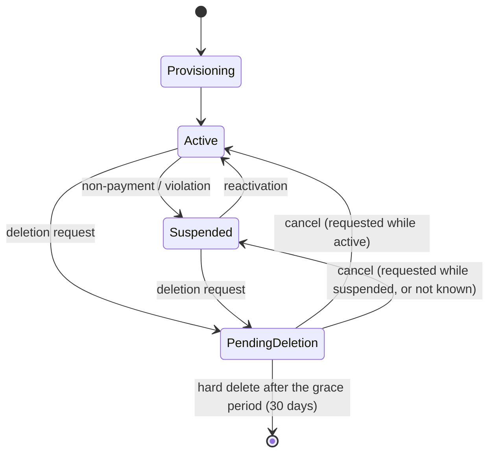

# Multi-Tenancy

One codebase runs both a private installation with a single user and a platform on which a provider
serves thousands of workspaces. Decision: [ADR-0010](../adr/ADR-0010-multi-tenancy.md).

---

## 1. Modes of operation

| Mode | `HUBTASK_TENANCY_MODE` | Behaviour |
|---|---|---|
| Single | `single` (default) | Exactly one tenant, created by the first start's setup ([UC-INS-01](../usecases/admin/UC-INS-01-start-a-fresh-installation.md)): a one-time code printed on the console, spent in the web app's *Set up Hubtask* card. No tenant selection in the API; registration optionally open |
| Multi | `multi` | The first tenant is created by the same setup, with its short name; every further one is provisioned through the control plane (§4.1); resolved as §3 says; self-service signup optional |

The code **always** knows about a tenant; single mode is one row in `tenant`. There is no second
code path and no special case in a repository.

---

## 2. Isolation strategy

**Shared database, shared schema, `tenant_id` on every business table, PostgreSQL row level
security as the boundary** — one migration for all tenants, minimal resources per tenant; noisy
neighbours need quotas (§4).

The growth path for special requirements (data residency, enterprise isolation) is **shard
routing**: a control plane database holds `tenant → shard`, the application picks the matching
pool, the data model stays identical. Not built.

### 2.1 RLS implementation

```sql
ALTER TABLE work_item ENABLE ROW LEVEL SECURITY;
ALTER TABLE work_item FORCE ROW LEVEL SECURITY;

CREATE POLICY tenant_isolation ON work_item
  USING (tenant_id = current_setting('app.tenant_id', true)::uuid)
  WITH CHECK (tenant_id = current_setting('app.tenant_id', true)::uuid);
```

**Roles and context**

* The application connects as `hubtask_app`: **no** `BYPASSRLS`, and **not** the table owner.
* Migrations run as `hubtask_migrator`, which **owns** the objects; `0001`'s default privileges
  name that role, so migrations under another owner would grant the application nothing.
* Exactly one place sets the context: the transaction wrapper in `infrastructure/postgres/Tenant.go`
  runs `SET LOCAL app.tenant_id = $1` and `SET LOCAL app.actor_id = $2` before every transaction —
  bound to the transaction, so safe under `pgbouncer` transaction pooling.
* A nested unit of work may not switch tenant (`postgres.tenant_switch_in_transaction`); a helper
  that may run inside somebody else's transaction reads in the ambient scope.
* Without a context, every query returns zero rows — "nothing found", never another tenant's data.
* **Installation scope.** Rows that belong to no tenant (the system capability profiles) are read
  with `app.tenant_id` set empty: `current_tenant_id()` is `NULL`, every tenant policy is false,
  and every `WITH CHECK` fails, so it is read-only by construction. `GET /meta/capabilities` uses it
  for an unauthenticated caller.

**Every table carries RLS with `FORCE`, with these exceptions.** The list is kept in three places
that must agree: `rlsExceptions` in `test/integration/tenant_boundary_test.go`, the restore drill's
copy in `cmd/restore-drill/checks.go`, and this table. A new exception is entered in all three.

| Table | Why it has no tenant policy | What bounds it instead |
|---|---|---|
| `job` | A worker must claim a job before it knows whose it is | The job names its tenant; the transaction that runs it is as bounded as a request |
| `goose_db_version` | The migration ledger | No grant to the application role; the readiness probe reads the applied version numbers through `applied_schema_versions()`, a `SECURITY DEFINER` function that answers nothing else |
| `instance_event` | The installation's own journal; its rows outlive the tenants they name ([audit.md](./audit.md) §6) | Append-only grants; written by the control plane's use cases; read only by `GET /admin/journal`, behind `admin:tenants` and the register |
| `item_capability_profile` | Has RLS but **no `FORCE`**: the system rows are the owner's to seed, and `FORCE` would bind the owner too ([ADR-0052](../adr/ADR-0052-managed-postgresql-support.md)) | The policy binds every non-owner role in full, `hubtask_app` included |
| `restore_drill_marker` | The restore drill's marker rows; no tenant column | No grant to the application role |
| `operator` | The operator register names accounts across workspaces | No grant to the application role; reachable only through narrow `SECURITY DEFINER` functions |
| `instance_setup_code` | The first start's one-time setup code ([UC-INS-01](../usecases/admin/UC-INS-01-start-a-fresh-installation.md)); it exists before any workspace does | No grant to the application role; reached only through the issuing and claiming `SECURITY DEFINER` functions |
| `instance_setting` | Installation configuration every workspace reads (§4.1) | Holds configuration, never personal data; written by one control-plane use case |
| `plan`, `plan_setting` | The plans every workspace on them reads (§4.2) | Hold configuration, never personal data; written by the control plane's use cases; no `DELETE` on `plan`, so a short name is never reused |
| `platform_event` | The installation's events for a purchase platform (§4.3): read across every workspace by the control plane, and the `deleted` event outlives its workspace | Identifiers and states only; written beside a control-plane change in its transaction; read only by `GET /admin/events`, behind `admin:tenants` and the register; the reference nulled at the purge, every row swept after 30 days |

**Doors through the boundary.** A `SECURITY DEFINER` function is the only way the application role
reads across tenants. Each is narrow by construction and granted to `hubtask_app` alone:

| Function | Answers | Used by |
|---|---|---|
| `resolve_tenant(slug)` | One tenant identifier or none — never a list | Sign-in before a credential exists (§3) |
| `admin_tenants()` | The list of tenants | The control plane behind `admin:tenants` (§4.1) |
| `admin_tenants_query(filters, after, size)` | One page of tenants matching the filters | The control plane: finding a workspace and reconciling a platform's records (§4.3) |
| `instance_census()` | Five counts, no rows | The instance overview |
| `subject_tenants(email)` | The tenants one data subject has an account in | An installation-wide data subject request ([data-protection.md](./data-protection.md) §4) |
| `is_operator`, `operator_roster(caller)`, `enlist_operator`, `dismiss_operator` | The operator register; the roster names only the register's own accounts, and nothing to a caller it does not name | The control plane (§4.1) |
| `purge_tenant_trail(tenant)` | Deletes one tenant's audit trail | The hard delete only ([audit.md](./audit.md) §3) |
| `remove_plan(plan, at, actor)` | `REMOVED`, `IN_USE` or `NOT_FOUND` — never a row | Removing a plan, refused while a workspace is on it (§4.2) |

**The doors' owner reads across tenants by policy.** `FORCE` binds the owner too, so a door owned
by a role that is neither superuser nor `BYPASSRLS` — the database an operator brings (§2.1.1) —
would see no rows. The owner therefore holds standing, command-scoped policies `TO CURRENT_USER`
(the role that runs the migration), bounded by no tenant, on exactly the tables the doors read
across tenants (`FOR SELECT`, plus `UPDATE` where a door writes). They give the owner nothing it
could not give itself, and `hubtask_app` nothing at all. No other role holds a policy that is not
`tenant_isolation`; the boundary test holds that.

**Nothing enumerates tenants.** No job, scheduler or worker lists the tenants. Every per-tenant duty
(outbox dispatch, retention, reminders, recurrence, backup and automation schedules, media
reconciliation, privacy deadlines, audit anchoring, reindex, embeddings, the hard-delete grace) is
**seeded by the write that creates its work**, in that tenant's transaction, with the tenant as the
dedupe key; each round reschedules itself while work remains (`queue.Result{Repeat: true}`). The
one listing is `admin_tenants()`, an operator's read, not a job. A duty that belongs to no tenant
(an instance-wide backup schedule, partition maintenance) is the leader's, under the installation
scope.

**Partitions.** A partition addressed directly does not inherit its parent's policy, so every
partition — and the `SECURITY DEFINER` function that creates one (`ensure_audit_partition`,
`ensure_stream_partition`) — carries its own policy, its own `FORCE` and its own revoked grants.

### 2.1.1 A database the operator brings

An installation may use a PostgreSQL it did not create (`database.enabled` off; the DSN from a
Secret), and the migrations run there too
([ADR-0052](../adr/ADR-0052-managed-postgresql-support.md); [support-matrix.md](./support-matrix.md)
§3). Such a service gives no superuser, so before the first migration the operator:

1. **Creates the two roles** with the service's admin account (`0001` reports a refused
   `CREATE ROLE` rather than failing). `hubtask_app` gets the password the application's DSN
   carries.
2. **Makes `hubtask_migrator` the database owner** — not the admin account: the grants in `0001`
   name that role, and default privileges for a role that owns nothing apply to nothing.

```sql
CREATE ROLE hubtask_migrator LOGIN PASSWORD '…';
CREATE ROLE hubtask_app      LOGIN PASSWORD '…';
CREATE DATABASE hubtask OWNER hubtask_migrator;
```

`HUBTASK_DB_DSN` connects as `hubtask_app`, the migration's DSN as `hubtask_migrator`; nothing needs
`SUPERUSER` or `BYPASSRLS`. The managed-database tests (`test/integration/managed_postgres_test.go`,
`managed_doors_test.go`, and the migration tests built on them) migrate under exactly this
arrangement; the rest of the integration suite, like Compose and CI, migrates as the superuser,
which `FORCE` does not bind.

### 2.1.2 References carry the tenant

Row level security does not check a foreign key — PostgreSQL validates a reference with the owner's
rights, so a single-column key would let a row in tenant A point at a row in tenant B
([ADR-0024](../adr/ADR-0024-tenant-scoped-foreign-keys.md)).

* **A foreign key between two tables whose `tenant_id` is `NOT NULL` is composite** over
  `(tenant_id, id)`. The referenced table carries `UNIQUE (tenant_id, id)`; its primary key stays
  `id`.
* `MATCH SIMPLE` (the default), so a `NULL` reference is not checked.
* `ON DELETE SET NULL` names its column — `ON DELETE SET NULL (column)` — or it would null
  `tenant_id` when it fires. This is why PostgreSQL 15 is the hard floor.
* A gate walks `pg_constraint` and fails the build on a single-column foreign key between two such
  tables, delete rule included.
* **Exception: the backup family**, where `tenant_id IS NULL` means installation-wide. A composite
  key is wrong there, not weaker; those references stay single-column.

### 2.2 Defence in depth

1. Authentication supplies the `tenant_id` (token claim or session), never the request body.
2. `ActorContext` carries tenant and actor, typed, through the application layer.
3. The permission check happens in the application layer (roles and scopes).
4. RLS is the last, unbypassable boundary.
5. Negative tests in CI: every repository method has a test that expects empty results or an error
   under the wrong tenant context (gate SG-3).

---

## 3. Tenant resolution

**Accounts are per tenant** (`account_email_uq` is `(tenant_id, lower(email))`), so a sign-in
resolves its tenant **before any credential is checked**.

**Signing in (no credential yet)** — `SessionWriter.resolveTenant`:

| Mode | Source, in order | Nothing resolves |
|---|---|---|
| Single | The one row (`resolve_tenant(NULL)`); the subdomain is ignored | — |
| Multi | 1. The subdomain under the base host (`resolve_tenant(slug)`) · 2. the `X-Hubtask-Tenant` header (a workspace identifier) | `404 auth.tenant_unresolved` |

**An authenticated request** — the credential binds the tenant: a session's or token's claim, a
personal access token's or service account's account.

In both cases the weaker sources **may confirm the tenant and never overrule it**. A header (or, on
an authenticated request, a subdomain) that names another tenant is refused with
`403 access.tenant_mismatch`. On an authenticated request the header may carry the identifier or
the slug. A path prefix is deliberately not used.

### 3.1 A workspace's address

**Decided, not built — milestone CD** ([decision #1568](https://github.com/Jersyfi/hubtask/issues/1568),
2026-10-16; the market research behind it in
[backlog/workspace-addressing-research-2026-10.md](../backlog/workspace-addressing-research-2026-10.md)).
The browser origin is a workspace's boundary on the client - its session, its offline cache, its
passkeys ([identity.md](./identity.md) §23.3) and the host its sign-in card shows - so every
workspace has a host of its own:

| Case | Address |
|---|---|
| One workspace on its own domain | Single mode, as today |
| Several workspaces, a wildcard on the base host | Multi mode: `<short name>.<base host>` |
| Several workspaces, no wildcard certificate | Multi mode with **hosts the operator assigns** per workspace |
| A workspace's own domain | Set up by its **owner** without the operator (a DNS proof, a certificate on demand); the operator sees every one and may block it; an installation switch allows it |

Never a path prefix, and never a root-domain workspace beside subdomain workspaces.

* **Changing the address.** The operator always; the owner where the installation allows it, behind
  a switch and a cooldown. The **old address is free at once**: no redirect, no hold. Every member
  with an address is told by mail; one without sees it at the next sign-in. Everyone signs in again,
  the workspace's passkeys end (their RP ID is the old host), and links, calendar subscriptions,
  MCP and `hubctl` set up on the old host stop working. Reserved short names are refused (the
  product's list and the operator's own).
* **Nobody is locked out** ([P-16](../vision/principles.md#p-16-nobody-is-locked-out)). A change is
  refused while it would leave the person making it, or the workspace's last owner, without a way
  in that survives it: a password (or a sign-in name) or a connected provider, plus an app factor
  or recovery codes where a factor is required. It is confirmed through that way, never through a
  passkey: a password step-up, or a fresh provider sign-in where passwords are off. A provider's
  return is one address per installation and is untouched by a workspace's change.
* **An own domain as the main address** costs what a change costs; the workspace's subdomain then
  stays with it and redirects, so the owner can switch back if the domain fails.
* **Switching** between workspaces is a list the device keeps (host and name only, never a token),
  in the web app on the base host and in the shells, with *Switch workspace*. There is no
  cross-workspace account, session or count ([NG-global-identity](../vision/non-goals.md)), no
  *Find your workspaces*, and no routing by an address or its domain: no screen tells anybody which
  workspaces an address belongs to.

---

## 4. Quotas, fairness, limits

A limit resolves `product → installation → plan → the operator's exception` (§4.2): the mode's
default below, the installation's default and lock, the workspace's plan where the installation
does not lock the limit, and the operator's exception per tenant in `tenant.settings.quotas`, written
through `PATCH /admin/tenants/{id}/quotas` and the last word. The workspace reads each limit through
`GET /quotas` with the level that set it (`source`) and the one that locked it (`lock`). Enforced
in the application layer and middleware; the per-token rate is resolved the same way in the
authentication query that already runs. A capacity quota refuses as `422 capacity.<quota>` naming the
ceiling; the rate as `429` with `Retry-After`. The approach to a ceiling is alert A-18.

| Limit | Default (multi) | Default (single/self-hosted) |
|---|---|---|
| API requests/min per token | 600 | 6,000 |
| Items per tenant | Unlimited unless a plan or the operator sets it | Unlimited |
| Media storage | Unlimited unless a plan or the operator sets it | Disk space |
| Automation runs/hour | 1,000 | 100,000 |
| Webhook targets | 50 | Unlimited |
| Bulk operations per request | 500 | 500 |
| Automation causality depth | 5 | 5 |
| Concurrent export jobs | 2 | 5 |
| People per workspace (decided for PL, §4.2) | Unlimited | Unlimited |
| AI tokens per day, offered models | 200,000 | Unlimited |
| AI tokens per day, the workspace's own model | Unlimited (the workspace's own setting) | Unlimited (the workspace's own setting) |

**The AI budget** is counted per source in provider-reported tokens over the workspace's calendar
day — midnight in `tenant.default_time_zone`, which is when it renews (UC-AI-07 check 2) — from the
billing ledger, whose two AI rows are dated by that day while every other metric keeps the UTC day.
A zone changed mid-day takes effect from the next call. A workspace over a budget **stops getting
answers from that source and keeps working** (`ai.unavailable` with `reason` `budget_spent` and
`renews_at`, the next midnight in its zone). `ai_tokens_per_day` limits the
models the installation **offers**, with the installation's default and the operator's exception per
workspace and per plan; a workspace's own model only by its optional `ai_own_tokens_per_day`, off by default,
which the workspace's administrator sets (`PUT /ai-budget`) and no installation value reaches
([ADR-0072](../adr/ADR-0072-ai-at-the-installation-level.md) §4). It is stored beside the quotas key
in `tenant.settings`, not in it, because the operator's quota write replaces that key whole.

**Fairness:** the job queue claims per tenant round-robin, so one tenant cannot monopolise the
workers; `statement_timeout` per role; a query DSL request whose estimated cost is over the cap is
refused before it runs.

---

## 4.1 The instance layer

The plane above the workspaces: it provisions them and sets values that apply to all of them
([ADR-0070](../adr/ADR-0070-the-instance-layer.md)).

**The control plane's credential.** Everything under `/admin/tenants` needs the `admin:tenants`
scope. No session carries it, except that a **registered operator** may raise their own session to
it for one hour with a step-up (`instance.session_elevated`, in the trail and `instance_event`).
Automation uses a personal access token minted for the purpose.

**Who an operator is.** A register (`operator`), checked when `admin:tenants` is minted and when it
is exercised. An empty register counts only for an active `OWNER` on an installation with exactly
one workspace ([identity.md](./identity.md) §19), so adding the first entry adds the person adding it
as well; only an active account is added. A service account may be an operator. Three ways
put somebody in besides the control plane itself: the first start's setup (its owner), the
environment (`HUBTASK_OPERATORS`), and the machine (`hubtask operator add`) when nobody is left
([UC-INS-01](../usecases/admin/UC-INS-01-start-a-fresh-installation.md),
[UC-INS-02](../usecases/admin/UC-INS-02-bring-an-installation-up-from-a-file.md),
[UC-INS-03](../usecases/admin/UC-INS-03-get-back-into-a-locked-installation.md)).

**What the census counts.** A workspace that holds no person - only service accounts - is not a
customer: the overview's workspace counts leave it out and name how many there are.

**What an instance setting is.** A row in `instance_setting` with a value **and a lock**. Open, a
workspace may tighten it; closed, it applies and the workspace's control is shown switched off with
the reason and who set it — never hidden. The effective value is resolved on read along
`product minimum → instance → plan → workspace`, so a change applies at once.

**How it is reached.** One API with three doors: a file (`seed` or `enforce`), `hubctl admin`, and
the web app's `/instance` area. The areas are the sign-in rule, the legal links, localisation
defaults, quota ceilings and `ai` — which AI sources a workspace may use and the least its own model
must declare ([ADR-0072](../adr/ADR-0072-ai-at-the-installation-level.md)). Every key answers its
kind (a count with the product's bounds, a flag, a choice or a list of choices from a closed set, a
link, a language, a zone), its position in its area and what an open key leaves a workspace free to
do (tighten it, go higher, use its own; nothing for a language, a zone or a week start), declared in
the domain beside the switch, so a screen draws every key with the control of its kind and keeps no
list of its own. The three doors read a document through one mapping in the use case and refuse
the same values ([UC-INS-09](../usecases/admin/UC-INS-09-set-defaults-and-locks-for-every-workspace.md)).

**What it never shows** is a workspace's contents: counts, states and limits (`instance_census()`),
never rows — the boundary is a database policy, not a role.

---

## 4.2 Plans

**Decided for milestone PL** ([ADR-0086](../adr/ADR-0086-plans-a-level-for-providers.md); the
owner, 2026-10-15). Built so far: plans, their doors and the record, moving a workspace,
provisioning on a plan, finding a workspace by the platform's reference, the sign-in rule and
legal links resolved through the plan ([identity.md](./identity.md) §18), what a plan leaves out,
the limits (§4) and the AI rule. Not built yet: the people limit and the account link - until they
merge, §4 and §4.1 describe what a workspace meets there.

Plans prepare Hubtask for a provider that sells it through its own purchase or billing platform
(§4.3). Hubtask ships no plan; a workspace without one has every entitlement and the installation's
limits, and an installation that never defines a plan — every self-hosted one — meets none of this. Plans exist only in multi mode — single
mode offers them nowhere.

**What a plan is.** An installation-level row (`plan`: a short name, a display name, a version) with
its values in the areas of §4.1 — the sign-in rule, the legal links, the quotas, `ai` — each with a
lock, and its entitlements. It holds only what it decides; the rest falls through to the
installation. `tenant.plan_id` references it; nothing is copied into a workspace, so a change is in
force at the workspace's next request, with no job. Like `instance_setting` it carries no row-level
policy, is read by every workspace and written only by the control plane, and the exception is in
all three boundary lists.

**How it resolves.** `product → installation → plan → workspace`, in every area:

* an installation lock binds the plan as it binds the workspace, and a plan's value under one is
  ignored on read, refused on write;
* a plan tightens what the installation left open — a limit goes higher only where the
  installation's key lets workspaces go higher — and may lock it; the lock's origin is `PLAN`, and a
  screen says "Set by your plan";
* the workspace tightens where neither locks; the operator's exception for one workspace stays the
  last word on a limit;
* a value a newly locked key overrides stays stored, and applies again when the lock goes.

**What a plan leaves out.** A closed set of three entitlements, each *included* unless the plan says
otherwise:

| Entitlement | Not included | Included again |
|---|---|---|
| Automation rules | no rule runs, by event or schedule; rules stay readable and cannot be created or switched on | they run from then on; a schedule without the occurrences it missed |
| Webhooks | nothing is delivered and no subscription is added; subscriptions and secrets stay | deliveries resume for events from then on |
| The workspace's own sign-in providers | they sign nobody in; connections and sealed secrets stay; offered providers are untouched; where no way in is left the password opens ([identity.md](./identity.md) §17.1) | they sign people in again |

A screen shows "Not included in your plan" where the person would otherwise have met the control
(P-05); `/meta/capabilities` answers the set as `not_included` to everybody signed in to the
workspace. An operation that creates, changes, switches on, runs or sends a feature declares it, and
the use case registry refuses it with `403 plan.not_included` through every door - switching off,
pausing, a new secret and removing stay. A rule's action that a plan leaves out is skipped, not
failed (automation.md §2.0). No entry of the set reaches export, deletion, access requests, language, time zone,
accessibility, or a door — REST, MCP, `hubctl`, tokens, the calendar feed (P-08).

**Downgrade.** A plan with a lower limit refuses the next creation past it and removes nothing
(P-03). The people limit (§4) counts active and managed accounts and open invitations, never service
accounts, and refuses the next invitation, managed account or account a provider would create.

**Doors and record.** Plans are created, changed, removed and assigned on the `/instance` screens,
with `hubctl admin plan`, through `/admin/plans` and in the instance file, with the same refusals; a
save carries the version it read and is refused with `version_conflict` otherwise. Provisioning
takes a plan. A plan with workspaces on it cannot be removed. Moving a workspace is written to
`instance_event` and the workspace's trail; changing a plan to `instance_event`.

**The account link.** An operator may set one address, at the installation and per plan, lockable
and resolved like the legal links ([identity.md](./identity.md) §18). Owners and administrators see
"Your provider's account page" beside "Not included in your plan", at a reached limit and on the
suspended page. Hubtask writes the label; no price, no other plan, no offer to upgrade.

---

## 4.3 The purchase platform's connection

**Decided for milestone PL** (the owner, 2026-10-16;
[ADR-0086](../adr/ADR-0086-plans-a-level-for-providers.md)). Built so far: naming, changing state in
order, finding, the credential, and the events with their feed; the subscriptions and the use are not
built yet. Plans exist so that a provider's own
purchase or billing platform can drive Hubtask: it pushes state in and reads use and events out
([P-15](../vision/principles.md#p-15-hubtask-holds-state-the-platform-holds-the-business),
`NG-billing`). Hubtask never asks the platform anything, and single mode offers none of this.

* **Its credential.** A service account in the operator register, with a token carrying
  `admin:provisioning` ([api-guidelines.md](./api-guidelines.md)) rather than all of
  `admin:tenants`, admitted by the verbs that declare it and refused everything else. It may request a
  deletion without a step-up, sending the typed name, when the register holds its own row as a
  service account's; the grace, the cancellation (the operator's), the export and the legal-hold
  refusal of §5 stay.
* **Naming.** A plan's short name never changes and is never reused once created; it is what the
  platform maps its products to. A workspace may carry the platform's own reference
  (`external_reference`: opaque, unique on the installation, changeable, `PERSONAL_TECHNICAL`,
  removed at the purge).
* **Changing state, in order.** A workspace has a version that grows with every change to its row —
  the control plane's and a workspace administrator's alike. A move or a lifecycle call may name
  the version it last saw and is refused with `version_conflict` when it is stale; repeated under
  its idempotency key it acts once. Its answer names the limits the workspace is now over, the
  entitlements that rest and the exceptions that stay.
* **Finding.** One workspace is read by its id (`GET /admin/tenants/{id}`, the version as its tag);
  `POST /admin/tenants:query` finds workspaces by short name, reference, plan or state, a page at a
  time - a `POST`, because a reference in a query string would reach access logs. A taken reference
  is refused without its value and without saying whose; its change is in the trail masked and in
  the journal without the value. It is not in the workspace's export: it is the provider's mapping,
  not the workspace's data.
* **Events.** Installation subscriptions sign, retry and dead-letter as a workspace's do (UC-INT-01),
  but are never switched off for being unreachable: the operator is told and the dead letters stay
  re-deliverable. Every event carries the workspace's id, reference, status, plan, version and
  moment, never content; "a limit reached" is sent once per crossing - again only after a create of
  that kind was admitted, or at a changed limit - and "the AI budget spent" once a day. The same events are read
  forward from a cursor (`GET /admin/events`), numbered in commit order (a number is drawn under an
  installation-wide lock held until the transaction ends), so a platform that was down misses
  nothing.
* **Use.** Recorded per workspace, metric and day; people, storage and entries as the day's highest
  count, written where the count changes (no job visits workspaces), the rest as sums. Every metric
  names its day (UTC, or the workspace's zone for the AI budget) and the read says up to which day it
  is final. Offered for billing (`GET /admin/usage`) only while the operator switches metering on,
  off by default. At the purge a workspace's counts move to an installation-level ledger keyed by
  the bare id and are kept, like every count, for 13 months.

---

## 5. The lifecycle of a tenant



| Phase | Actions |
|---|---|
| Provisioning | Tenant, default hub, example collection, owner membership, locale/time zone, standard buckets/labels; idempotent under `Idempotency-Key` |
| Active | Normal operation; metering only if enabled |
| Suspended | The API answers `403 access.tenant_suspended`; data remains; the export still works |
| PendingDeletion | Access blocked (`403 access.tenant_pending_deletion`), automations disabled, the export still works. A deletion request is refused while a legal hold in the workspace is in force, and a workspace already here stays here until the last hold is lifted ([data-protection.md](./data-protection.md) §5); its grace job comes back daily and removes nothing while one stands, and no hold can be placed here |
| Cancel | The operator calls a pending deletion off until the hard delete begins - also past the deadline while a legal hold keeps the workspace pending, whose holds stay. The workspace returns to the status the request found it in (kept in `status_before_deletion`; `SUSPENDED` where it was not kept), the deadline is cleared, and the automation rules the request switched off (`paused_for_deletion`) come back on, a schedule from now without the occurrences it missed. No step-up and no typed name: it removes nothing. The grace job marks the row (`purge_started_at`) before its first byte goes, and a cancel is refused `admin.tenant_deletion_underway` from then on; both write the same row, so one waits for the other |
| Hard delete | A job seeded by the deletion request's own write runs after the grace period. It cascades across every storage location — database rows, media objects, search entries, outbox, queue — and purges the tenant's audit trail; the evidence goes to `instance_event` in the same transaction ([audit.md](./audit.md) §6) |

Deleting a tenant demands a step-up and the typed tenant name — from a person; a purchase
platform's service account that is a registered operator sends the typed name without one (§4.3); a
person, an agent and the empty register's owner still give one. In single mode the one workspace is
the installation and holds every operator: suspending it and requesting its deletion are refused
(`admin.multi_mode_required`), because either would shut everybody out with no way back; resuming
and cancelling stay open in every mode. A workspace that got there anyway - before the refusal, or
whose every operator sits in it - is brought back on the machine: `hubtask workspace
cancel-deletion --workspace <short name>`, then `hubtask workspace resume --workspace <short name>`,
the same two use cases recorded as the machine's ([identity.md](./identity.md) §19). The hard delete removes the workspace
from the primary system at once and from the operator's system backups **35 days** later
([data-protection.md](./data-protection.md) §5).

**Export:** `POST /admin/tenants/{id}:export` writes one complete, unencrypted archive of the
workspace ([tenant-export.md](./tenant-export.md)) to a backup target, as a job, in every lifecycle
state. It reads through the same RLS path as the API (T-20), is audited with its target, never its
content, and counts against the §4 export quota. The target is the workspace's own or one of the
installation's own targets ([backup-restore.md](./backup-restore.md) §2) - so in multi mode with
`HUBTASK_BACKUP_TENANT_TARGETS=false` (the default) the operator exports to a target of the
installation. It is checked when the export is accepted: an unknown target answers
`backup.target_not_found`, a disabled one `backup.target_disabled`.

---

## 6. Data protection

Data subject rights, erasure modes, the data catalogue and residency are
[data-protection.md](./data-protection.md) (§4–§6). What tenancy adds: integration secrets are
encrypted at the application level (AES-GCM) on top of TLS in transit and the infrastructure's
encryption at rest, and logs carry identifiers only, never item or comment content.

---

## 7. Consequences for scaling

* All processes are stateless → any number of `api` replicas.
* Reads may go to read replicas (the `persistence` port allows `ReadOnly` transactions). Replication
  lags, so a read after a write in the same request uses the primary.
* `audit_log`, `change_log`, `activity_entry`, `outbox_event` and `rule_run` partition by month: a
  default catch-all partition, RLS per partition (§2.1), the leader creating coming months, an
  aged-out month dropped whole with evidence in the instance journal. `work_item` can partition by
  `tenant_id` hash if ever needed; the `tenant_id` index prefix prepares for it.
* The `scheduler` stays single-leader; the work itself is distributed as jobs.
